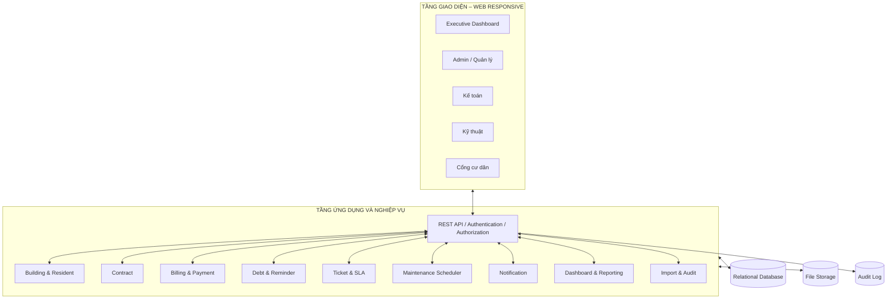
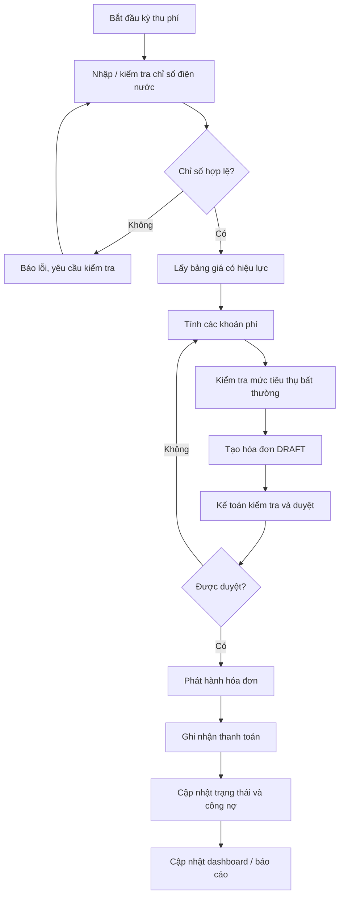
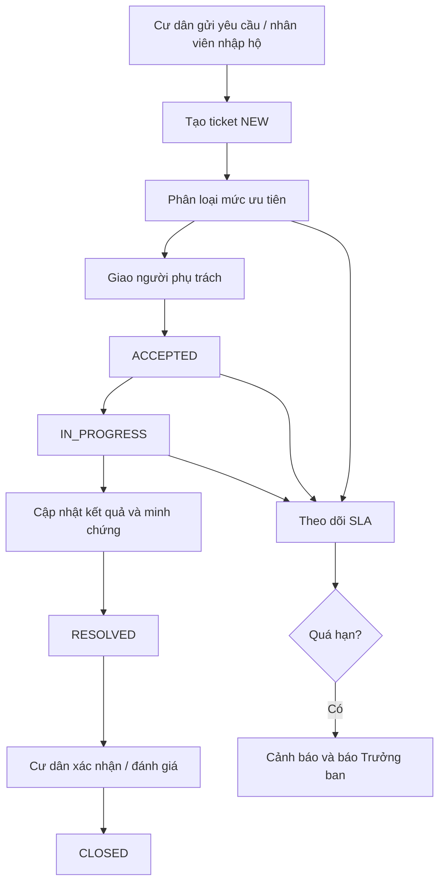
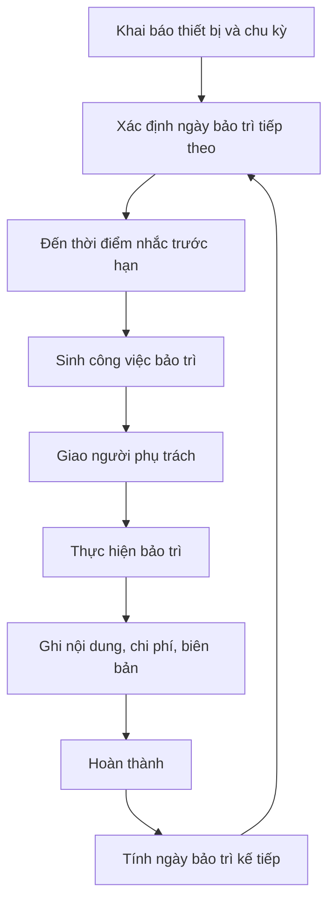
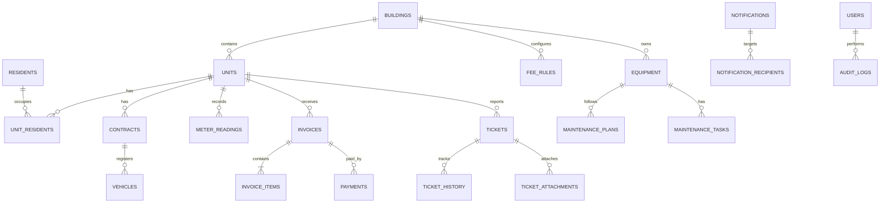

# ĐẶC TẢ YÊU CẦU PHẦN MỀM (SRS)
## Software Requirements Specification
### Smart Building Management System – Hệ thống quản lý vận hành tòa nhà

- **Phiên bản:** 1.0 – Bản dự thảo
- **Ngày lập:** 04/11/2026
- **Tài liệu đầu vào:** BRD – Hệ thống quản lý tòa nhà (Building Management System), phiên bản 0.2
- **Mục đích:** Chuyển hóa yêu cầu nghiệp vụ trong BRD thành yêu cầu phần mềm có thể thiết kế, phát triển và kiểm thử.

> Các yêu cầu chức năng được đánh mã `FR`; yêu cầu phi chức năng được đánh mã `NFR`. Những chi tiết chưa được BRD xác định rõ được ghi là **đề xuất** hoặc đưa vào mục cần xác nhận, không xem là yêu cầu đã được chủ đầu tư chốt.

---

# 1. GIỚI THIỆU (INTRODUCTION)

## 1.1. Mục đích tài liệu

Tài liệu SRS mô tả các yêu cầu phần mềm của Smart Building Management System, làm căn cứ cho:
- Thiết kế kiến trúc và cơ sở dữ liệu.
- Thiết kế API và giao diện người dùng.
- Phân chia công việc phát triển.
- Xây dựng kịch bản kiểm thử.
- Đánh giá và nghiệm thu sản phẩm.

## 1.2. Phạm vi sản phẩm

Hệ thống là ứng dụng web quản lý tập trung một hoặc nhiều tòa nhà, hỗ trợ Ban quản lý kiểm soát dữ liệu tòa nhà, căn hộ, cư dân, hợp đồng, phí dịch vụ, hóa đơn, thanh toán, công nợ, sự cố và bảo trì thiết bị.

Các phân hệ chính:

| Mã | Phân hệ | Mô tả |
|---|---|---|
| BMS-01 | Quản trị dữ liệu và nhập dữ liệu | Quản lý danh mục, import Excel/CSV, chuẩn hóa và kiểm tra dữ liệu |
| BMS-02 | Tòa nhà, căn hộ, cư dân và hợp đồng | Quản lý thông tin căn hộ, cư dân, hợp đồng và phương tiện |
| BMS-03 | Phí, hóa đơn và thanh toán | Ghi chỉ số, tính phí, tạo hóa đơn, ghi nhận thanh toán và công nợ |
| BMS-04 | Dashboard và báo cáo | KPI điều hành, biểu đồ, cảnh báo và xuất báo cáo |
| BMS-05 | Sự cố và SLA | Tiếp nhận, phân loại, giao việc, theo dõi và đánh giá sự cố |
| BMS-06 | Thiết bị và bảo trì | Quản lý thiết bị, lịch bảo trì, công việc và lịch sử sửa chữa |
| BMS-07 | Thông báo | Gửi thông báo theo tòa, tầng, nhóm hoặc cá nhân |
| BMS-08 | Phân quyền và nhật ký | RBAC, giới hạn dữ liệu theo tòa và audit log |

## 1.3. Đối tượng sử dụng

| Vai trò | Nhu cầu sử dụng |
|---|---|
| Executive / Chủ đầu tư | Xem dashboard, báo cáo thu phí, công nợ, sự cố, tỷ lệ lấp đầy |
| Admin / Ban quản lý | Quản trị dữ liệu, điều phối nghiệp vụ, quản lý người dùng và cấu hình |
| Accountant / Kế toán | Nhập chỉ số, cấu hình phí, tạo hóa đơn, ghi nhận thanh toán, theo dõi công nợ |
| Technician / Kỹ thuật | Tiếp nhận và xử lý sự cố, thực hiện bảo trì, cập nhật kết quả |
| Resident / Cư dân | Xem hóa đơn, gửi và theo dõi sự cố, nhận thông báo |

## 1.4. Định nghĩa và thuật ngữ

| Thuật ngữ | Ý nghĩa |
|---|---|
| BMS | Building Management System – Hệ thống quản lý tòa nhà |
| BRD | Business Requirements Document – Tài liệu yêu cầu nghiệp vụ |
| SRS | Software Requirements Specification – Tài liệu đặc tả yêu cầu phần mềm |
| Master Data | Dữ liệu danh mục: tòa nhà, căn hộ, cư dân, thiết bị, bảng giá |
| Transactional Data | Dữ liệu giao dịch: hợp đồng, chỉ số, hóa đơn, thanh toán, sự cố, bảo trì |
| Billing Engine | Thành phần tính phí và tạo hóa đơn |
| Debt Engine | Thành phần theo dõi công nợ và nhắc nợ |
| SLA | Cam kết thời hạn tiếp nhận và xử lý sự cố |
| RBAC | Phân quyền dựa trên vai trò |
| Audit Log | Nhật ký thao tác quan trọng |
| KPI | Chỉ số đánh giá hiệu quả |
| CCR | Context – Complication – Resolution |

## 1.5. Tài liệu tham chiếu

- BRD – Hệ thống quản lý tòa nhà (Building Management System), phiên bản 0.2, ngày 04/11/2026.
- Tài liệu SRS tham khảo do người dùng cung cấp: [03_Dac_ta_Yeu_cau_Phan_mem_SRS.md](https://github.com/cuongpt083/gsj-localbrand-src/blob/main/docs/03_Dac_ta_Yeu_cau_Phan_mem_SRS.md).

---

# 2. MÔ TẢ TỔNG QUAN HỆ THỐNG (SYSTEM OVERVIEW)

## 2.1. Kiến trúc tổng thể

**Định hướng đề xuất:** Web Client – REST API – Business Services – Relational Database. BRD chưa bắt buộc công nghệ triển khai cụ thể.

- **Presentation Layer:** Giao diện web responsive cho Ban quản lý, kế toán, kỹ thuật và cư dân.
- **Application/API Layer:** Tiếp nhận request, xác thực, kiểm tra quyền và điều phối nghiệp vụ.
- **Business Layer:** Xử lý tính phí, hóa đơn, công nợ, SLA, bảo trì, thông báo và báo cáo.
- **Data Layer:** Lưu dữ liệu danh mục, giao dịch, tệp đính kèm và nhật ký.

Nếu sử dụng stack Java/React, có thể cân nhắc React, Java Spring Boot và PostgreSQL. Đây là định hướng kỹ thuật tham khảo, cần được xác nhận riêng.



## 2.2. Các luồng nghiệp vụ chính

### 2.2.1. Chu kỳ thu phí



### 2.2.2. Xử lý sự cố



### 2.2.3. Bảo trì thiết bị



## 2.3. Phạm vi triển khai

### Trong phạm vi
- Quản trị và làm sạch dữ liệu; nhập tòa nhà, căn hộ, cư dân, chỉ số công tơ.
- Billing Engine, Debt Engine, SLA Engine và Maintenance Scheduler.
- Dashboard điều hành, màn hình vận hành và cổng cư dân.
- Phân quyền theo vai trò và theo tòa nhà.
- Nhật ký thao tác quan trọng.

### Ngoài phạm vi
- Tích hợp IoT thời gian thực (công tơ thông minh, camera, kiểm soát ra vào).
- Cổng thanh toán trực tuyến.
- Kế toán đầy đủ (sổ cái, thuế).
- Ứng dụng di động native.
- Đặt tiện ích chung và marketplace nội khu.
- AI phức tạp như nhận diện hình ảnh hoặc dự đoán hỏng hóc.

## 2.4. Giả định và ràng buộc

- Dữ liệu ban đầu được cung cấp từ Excel/CSV.
- Ban quản lý chịu trách nhiệm xác nhận dữ liệu đầu vào.
- Bảng giá, ngưỡng nhắc nợ, SLA và chu kỳ bảo trì do người có quyền cấu hình.
- Người dùng có tài khoản và được gán vai trò/phạm vi tòa.
- Cư dân sử dụng web responsive trong giai đoạn đầu.

---

# 3. ĐẶC TẢ YÊU CẦU CHỨC NĂNG (FUNCTIONAL REQUIREMENTS)

## 3.1. BMS-01 – Quản trị dữ liệu và nhập dữ liệu

### FR-01.1 – Quản lý dữ liệu danh mục
- Hệ thống cho phép người có quyền tạo, xem và cập nhật thông tin tòa nhà.
- Mỗi căn hộ thuộc một tòa nhà và có mã căn duy nhất theo phạm vi được thống nhất.
- Danh mục cư dân, thiết bị và bảng giá được quản lý tập trung.
- Dữ liệu danh mục đã được sử dụng trong giao dịch không nên bị xóa cứng; đề xuất chuyển sang trạng thái ngừng hoạt động để bảo toàn lịch sử.

### FR-01.2 – Import Excel/CSV
- Người dùng có quyền được tải lên tệp Excel/CSV theo mẫu.
- Hệ thống hỗ trợ import danh sách tòa, căn hộ, cư dân và chỉ số công tơ.
- Hệ thống kiểm tra trường bắt buộc, định dạng, dữ liệu trùng và quan hệ tham chiếu trước khi ghi dữ liệu.
- Kết quả phải hiển thị tổng dòng hợp lệ, tổng dòng lỗi và lỗi theo từng dòng/cột.
- Không được âm thầm bỏ qua dòng lỗi.
- **Đề xuất:** có màn hình xem trước và xác nhận trước khi import chính thức.

### FR-01.3 – Chuẩn hóa dữ liệu
- Ngày tháng chuẩn hóa theo `YYYY-MM-DD`.
- Tiền tệ được chuẩn hóa thành số nguyên VNĐ; ví dụ `1.250.000`, `1,250,000`, `1250k` phải được xử lý theo quy tắc import thống nhất.
- Mã căn chuyển về chữ hoa, không dấu; ví dụ `a1-1205` thành `A1-1205`.
- Số điện thoại theo một định dạng thống nhất.
- Trạng thái dữ liệu sử dụng các giá trị chuẩn của hệ thống.
- Dữ liệu không thể chuẩn hóa phải được báo lỗi, không tự suy đoán.

### FR-01.4 – Kiểm tra toàn vẹn
- Không cho phép trùng `unit_code`, `invoice_no`, `ticket_no`.
- Bản ghi vi phạm được gắn cờ chất lượng dữ liệu.
- Kiểm tra quan hệ tham chiếu giữa tòa, căn hộ, cư dân và giao dịch.

### FR-01.5 – Phân loại dữ liệu
- Master Data: `buildings`, `units`, `residents`, `equipment`, `fee_rules`.
- Transactional Data: `contracts`, `meter_readings`, `invoices`, `invoice_items`, `payments`, `tickets`, `maintenance_tasks`.

## 3.2. BMS-02 – Quản lý tòa nhà, căn hộ, cư dân và hợp đồng

### FR-02.1 – Quản lý tòa nhà và căn hộ
- Admin được tạo, xem và cập nhật thông tin tòa nhà.
- Admin quản lý danh sách căn hộ/phòng thuộc từng tòa.
- Thông tin căn hộ gồm mã căn, tầng, diện tích, tòa nhà và trạng thái.
- Trạng thái căn hộ: `VACANT`, `OCCUPIED`, `MAINTENANCE`.

### FR-02.2 – Quản lý cư dân
- Lưu thông tin cư dân: mã cư dân, họ tên, số điện thoại và thông tin liên hệ cần thiết.
- Một căn hộ có thể liên kết cư dân chính và thành viên đi cùng.
- Cư dân chỉ xem dữ liệu căn hộ được liên kết với tài khoản của mình.

### FR-02.3 – Quản lý hợp đồng
- Hợp đồng gắn với căn hộ và cư dân chính.
- Vòng đời hợp đồng: `DRAFT → ACTIVE → EXPIRING → EXPIRED` hoặc `TERMINATED`.
- Hệ thống cảnh báo khi hợp đồng sắp hết hạn theo ngưỡng cấu hình.
- Mỗi căn hộ chỉ có một hợp đồng `ACTIVE` tại một thời điểm.
- Hợp đồng có thể liên kết thành viên đi cùng và phương tiện đăng ký.

### FR-02.4 – Quản lý phương tiện
- Phương tiện được liên kết với hợp đồng/căn hộ.
- Loại phương tiện là căn cứ tính phí gửi xe.
- **Cần xác nhận:** danh mục loại phương tiện, số lượng tối đa và cách tính phí.

## 3.3. BMS-03 – Quản lý phí, hóa đơn và thanh toán

### FR-03.1 – Quản lý bảng giá
- Người có quyền tạo và cập nhật bảng giá.
- Bảng giá gồm phí quản lý theo m², điện, nước, gửi xe và phí khác.
- Mỗi bảng giá có thời gian bắt đầu/kết thúc hiệu lực.
- Hóa đơn sử dụng bảng giá có hiệu lực tại kỳ tính phí.

### FR-03.2 – Ghi nhận chỉ số công tơ
- Kế toán nhập chỉ số đầu kỳ và cuối kỳ theo căn hộ/kỳ.
- Tiêu thụ = chỉ số cuối kỳ − chỉ số đầu kỳ.
- Chỉ số cuối kỳ không được nhỏ hơn chỉ số đầu kỳ.
- Khi thay công tơ phải có ghi chú và chỉ số chốt công tơ cũ.
- Lưu người nhập và thời điểm ghi nhận.

### FR-03.3 – Tính phí điện/nước
- Tính mức tiêu thụ trong kỳ từ chỉ số hợp lệ.
- Mỗi bậc tiêu thụ nhân với đơn giá của bậc đó.
- Tổng tiền bằng tổng tiền các bậc.
- Hiển thị chi tiết phép tính để kế toán/cư dân kiểm tra.

### FR-03.4 – Tính các khoản phí khác
- Phí quản lý = đơn giá/m² × diện tích căn hộ.
- Phí gửi xe theo loại phương tiện đã đăng ký.
- Phí khác và giảm trừ phải có khoản mục, số tiền và ghi chú/lý do khi cần.

### FR-03.5 – Tạo hóa đơn
Quy trình:
1. Đọc chỉ số công tơ hợp lệ.
2. Lấy bảng giá có hiệu lực và tính từng khoản.
3. Áp dụng giảm trừ và phạt chậm (nếu có).
4. Kiểm tra tiêu thụ bất thường so với các kỳ gần nhất.
5. Tạo hóa đơn `DRAFT` chờ kế toán duyệt và phát hành.

```text
Tổng hóa đơn =
    Phí quản lý + Điện + Nước + Gửi xe
  + Phí khác - Giảm trừ + Phạt chậm
```

- Hóa đơn có mã duy nhất, căn hộ, kỳ tính phí, ngày tạo, hạn thanh toán, tổng tiền và chi tiết khoản mục.
- Không phát hành hóa đơn khi dữ liệu tính phí chưa hợp lệ.
- Hóa đơn đã phát hành không được xóa; chỉ điều chỉnh bằng nghiệp vụ có lý do và người duyệt.

### FR-03.6 – Duyệt và phát hành
- Kế toán tạo hóa đơn nháp.
- Người có quyền duyệt xem chi tiết trước khi phát hành.
- Khi phát hành, trạng thái chuyển thành `ISSUED`.
- Lưu người thực hiện và thời điểm phát hành.
- Mọi điều chỉnh hóa đơn đã phát hành phải lưu lý do và người duyệt.

### FR-03.7 – Ghi nhận thanh toán
- Kế toán ghi nhận thanh toán thủ công hoặc từ đối soát sao kê.
- Thông tin gồm hóa đơn, số tiền, ngày thanh toán, phương thức và người ghi nhận.
- Hỗ trợ thanh toán một phần hoặc toàn bộ.
- Trạng thái `PARTIAL` khi đã thanh toán một phần; `PAID` khi đã thanh toán đủ.
- Lưu lịch sử các lần thanh toán.
- Không triển khai cổng thanh toán trực tuyến trong giai đoạn đầu.

### FR-03.8 – Theo dõi công nợ và nhắc nợ
- Công nợ = số phải thu − số đã thu.
- Hóa đơn chưa thanh toán sau hạn được xác định là quá hạn theo quy tắc nghiệp vụ.
- Phân khúc hành vi: đúng hạn, trễ thỉnh thoảng, trễ thường xuyên, nợ kéo dài và người thuê mới.
- Ngưỡng phân khúc do Ban quản lý cấu hình.
- Hỗ trợ nhắc trước hạn và nhắc nợ theo phân khúc.
- Phạt chậm theo hợp đồng, chỉ tính sau hạn và không vượt mức pháp luật cho phép.

### FR-03.9 – Cổng hóa đơn cư dân
- Cư dân xem danh sách và chi tiết hóa đơn thuộc căn hộ của mình.
- Chi tiết thể hiện khoản phí, chỉ số, đơn giá, số đã thanh toán và số còn phải trả.
- Cư dân không được xem hóa đơn của căn hộ khác.

## 3.4. BMS-04 – Dashboard và báo cáo

### FR-04.1 – Bộ lọc
- Dashboard lọc theo tòa nhà và kỳ/thời gian.
- Chỉ hiển thị dữ liệu thuộc phạm vi được phân quyền.

### FR-04.2 – KPI chính
Dashboard hiển thị tối thiểu:
1. Tỷ lệ thu phí kỳ hiện tại = số tiền đã thu / số tiền phải thu × 100%.
2. Công nợ quá hạn: tổng tiền và số căn có công nợ quá hạn.
3. Sự cố đang mở: tổng số sự cố chưa đóng và số sự cố vượt SLA.

### FR-04.3 – Chỉ số bổ sung
- Tỷ lệ lấp đầy = số căn `OCCUPIED` / tổng số căn khai thác × 100%.
- Tỷ lệ thu phí theo tháng.
- Sự cố theo loại và mức ưu tiên.
- Số sự cố quá SLA.
- Thiết bị sắp đến hạn bảo trì.
- Thời gian xử lý sự cố trung bình.
- Chi phí sửa chữa lũy kế theo thiết bị nếu có dữ liệu.

### FR-04.4 – Nguyên tắc dashboard 90 giây
- Ba KPI chính xuất hiện ngay trên màn hình đầu.
- Không quá 4 biểu đồ trên dashboard điều hành chính.
- Biểu đồ có tiêu đề, đơn vị, kỳ dữ liệu và phạm vi tòa rõ ràng.

### FR-04.5 – Trình bày theo CCR
Các biểu đồ quan trọng có phần giải thích:
- **Context:** Bối cảnh và tình hình thực tế.
- **Complication:** Vấn đề hoặc điểm nghẽn.
- **Resolution:** Hành động/khuyến nghị cần xem xét.

Phần Resolution trong phạm vi này là gợi ý dựa trên quy tắc và dữ liệu hiện có, không mặc định là nội dung do AI sinh ra.

### FR-04.6 – Xuất báo cáo
- Người có quyền xuất báo cáo Excel hoặc PDF.
- Báo cáo thể hiện kỳ báo cáo, phạm vi tòa và thời điểm xuất.
- Dữ liệu xuất tuân theo quyền truy cập.

## 3.5. BMS-05 – Quản lý sự cố và SLA

### FR-05.1 – Tạo yêu cầu
- Cư dân gửi mô tả, nhóm sự cố và hình ảnh đính kèm nếu có.
- Nhóm sự cố: điện, nước, thang máy, vệ sinh, an ninh, khác.
- Lễ tân/bảo vệ có thể nhập hộ khi tiếp nhận qua điện thoại.
- Hệ thống sinh mã ticket duy nhất; trạng thái ban đầu `NEW`.

### FR-05.2 – Phân loại ưu tiên

| Mức ưu tiên | Ví dụ |
|---|---|
| Khẩn cấp | Cháy, thang máy kẹt người, vỡ ống chính |
| Cao | Mất điện/nước cả tầng, rò rỉ nước |
| Trung bình | Hỏng đèn hành lang, điều hòa khu chung |
| Thấp | Hỏi thông tin, góp ý |

Ban quản lý cấu hình thời hạn tiếp nhận và xử lý cho từng mức ưu tiên.

### FR-05.3 – Giao việc và trạng thái
- Người có quyền phân công ticket cho nhân viên/bộ phận.
- Vòng đời: `NEW → ACCEPTED → IN_PROGRESS → RESOLVED → CLOSED`.
- Lưu người thực hiện và thời điểm mỗi lần chuyển trạng thái.
- Kỹ thuật viên xem ticket được giao và cập nhật tiến độ.
- Cư dân theo dõi ticket do mình gửi.

### FR-05.4 – Theo dõi SLA
- Tính thời hạn tiếp nhận và xử lý theo mức ưu tiên.
- Ticket quá hạn phải được đánh dấu vi phạm SLA.
- Cảnh báo hiển thị trên dashboard và gửi Trưởng ban theo cấu hình.
- Lưu lịch sử cảnh báo.

### FR-05.5 – Hoàn thành và đánh giá
- Khi chuyển `RESOLVED`, nhân viên nhập kết quả xử lý.
- Ticket Khẩn cấp và Cao phải có kết quả và hình ảnh/biên bản mới được chuyển `RESOLVED`.
- Cư dân xác nhận và chấm điểm từ 1 đến 5.
- Lưu đánh giá và phản hồi.

## 3.6. BMS-06 – Quản lý thiết bị và bảo trì

### FR-06.1 – Danh mục thiết bị
- Quản lý thang máy, PCCC, máy bơm, điều hòa trung tâm, máy phát điện và thiết bị khác.
- Mỗi thiết bị gắn với tòa, vị trí, nhà cung cấp và ngày đưa vào sử dụng.
- Mỗi thiết bị có mã định danh duy nhất.

### FR-06.2 – Lịch bảo trì
- Người có quyền cấu hình chu kỳ theo ngày hoặc tháng.
- Hệ thống xác định ngày bảo trì tiếp theo.
- Tự sinh công việc trước hạn và nhắc người phụ trách.
- Hiển thị công việc sắp đến hạn, đến hạn và quá hạn.

### FR-06.3 – Ghi nhận bảo trì
- Nhân viên ghi nội dung, người thực hiện, chi phí và biên bản/hình ảnh.
- Lưu lịch sử theo thiết bị.
- Sau khi hoàn thành, hệ thống tính ngày bảo trì kế tiếp.

### FR-06.4 – Thiết bị hỏng lặp lại
- Thống kê số lần sự cố/sửa chữa theo thiết bị trong khoảng thời gian cấu hình.
- Thiết bị hỏng lặp lại bị gắn cờ “cân nhắc thay thế”.
- Dashboard hiển thị tổng chi phí sửa chữa lũy kế.
- Ngưỡng “nhiều lần” và “thời gian ngắn” cần Ban quản lý xác nhận.

## 3.7. BMS-07 – Thông báo

### FR-07.1 – Tạo và gửi thông báo
- Tạo thông báo toàn tòa, theo tầng, theo nhóm hoặc cá nhân.
- Loại thông báo: vận hành, hóa đơn, nhắc hạn, trạng thái sự cố và lịch bảo trì.
- Người tạo chọn phạm vi người nhận.
- Lưu người gửi, thời điểm, nội dung và danh sách người nhận.

### FR-07.2 – Trạng thái đọc
- Người nhận xem thông báo của mình.
- Hệ thống lưu trạng thái đã đọc/chưa đọc.
- Người dùng không xem được thông báo cá nhân ngoài phạm vi.
- Kênh gửi (in-app, email, SMS...) chưa được BRD chốt; đề xuất giai đoạn đầu triển khai thông báo trong hệ thống.

## 3.8. BMS-08 – Phân quyền và nhật ký

### FR-08.1 – Quản lý tài khoản
- Admin tạo, cập nhật, khóa/mở tài khoản theo quyền.
- Tài khoản được gán vai trò.
- Tài khoản cư dân liên kết với cư dân/căn hộ tương ứng.

### FR-08.2 – Phân quyền RBAC

| Vai trò | Quyền chính |
|---|---|
| Admin | Quản trị hệ thống và cấu hình trong phạm vi được giao |
| Manager | Điều hành, quản lý và phê duyệt theo quyền |
| Accountant | Chỉ số, bảng giá, hóa đơn, thanh toán, công nợ |
| Technician | Ticket, thiết bị và bảo trì |
| Resident | Hóa đơn, thông báo, gửi/theo dõi sự cố căn hộ |

- Mọi API nghiệp vụ phải kiểm tra quyền ở phía máy chủ.
- Ẩn chức năng trên giao diện không phải cơ chế bảo mật duy nhất.

### FR-08.3 – Phân quyền theo tòa
- Người dùng chỉ truy cập dữ liệu các tòa được phân công.
- Cư dân chỉ truy cập dữ liệu căn hộ của mình.
- Quy tắc này áp dụng cho danh sách, chi tiết, API và báo cáo xuất.

### FR-08.4 – Audit Log
Ghi nhật ký các thao tác quan trọng như sửa hóa đơn, đổi trạng thái hợp đồng, đổi bảng giá, đổi phân quyền. Mỗi bản ghi gồm người thực hiện, thời điểm, loại thao tác, đối tượng và giá trị trước/sau khi có. Người dùng thông thường không được sửa hoặc xóa nhật ký.

---

# 4. YÊU CẦU GIAO DIỆN NGƯỜI DÙNG (USER INTERFACE)

## 4.1. Bố cục tổng thể

```text
+--------------------------------------------------------------------------------+
| SMART BUILDING MANAGEMENT SYSTEM                         [Thông báo] [Tài khoản]|
+----------------------+---------------------------------------------------------+
| MENU                 | TỔNG QUAN ĐIỀU HÀNH                                     |
| - Dashboard          | [Tỷ lệ thu phí] [Công nợ quá hạn] [Sự cố đang mở]       |
| - Tòa nhà            |                                                         |
| - Căn hộ             | [Bộ lọc: Tòa nhà] [Kỳ báo cáo]                           |
| - Cư dân             | [Biểu đồ thu phí] [Công nợ theo tòa]                     |
| - Hợp đồng           | [Sự cố theo trạng thái] [Thiết bị sắp bảo trì]           |
| - Chỉ số điện nước   | [Danh sách cảnh báo / việc cần xử lý]                  |
| - Bảng giá           |                                                         |
| - Hóa đơn            |                                                         |
| - Thanh toán         |                                                         |
| - Sự cố              |                                                         |
| - Thiết bị & bảo trì |                                                         |
| - Thông báo          |                                                         |
| - Người dùng         |                                                         |
+----------------------+---------------------------------------------------------+
```

## 4.2. Danh sách màn hình

| Màn hình | Thành phần chính | Thao tác |
|---|---|---|
| Đăng nhập | Tên đăng nhập/email, mật khẩu | Đăng nhập/đăng xuất |
| Dashboard | KPI, biểu đồ, bộ lọc, cảnh báo | Xem chi tiết, lọc, xuất báo cáo |
| Tòa nhà | Danh sách và thông tin tòa | Thêm, sửa, xem |
| Căn hộ | Mã căn, tầng, diện tích, trạng thái | Thêm, sửa, tìm kiếm |
| Cư dân | Thông tin và căn hộ liên kết | Thêm, sửa, xem |
| Hợp đồng | Thời hạn, cư dân, trạng thái | Tạo, cập nhật, chấm dứt |
| Chỉ số công tơ | Kỳ, chỉ số đầu/cuối, tiêu thụ | Nhập, import, kiểm tra |
| Bảng giá | Loại phí, đơn giá, hiệu lực | Tạo, cập nhật |
| Hóa đơn | Mã, kỳ, căn hộ, số tiền, trạng thái | Tạo nháp, duyệt, phát hành |
| Thanh toán/công nợ | Số đã thu, còn nợ, hạn thanh toán | Ghi nhận, tra cứu, nhắc nợ |
| Sự cố | Ticket, ưu tiên, SLA, người phụ trách | Tạo, phân công, cập nhật |
| Thiết bị | Mã, vị trí, trạng thái | Thêm, cập nhật, xem lịch sử |
| Bảo trì | Lịch, công việc, người phụ trách | Tạo lịch, giao việc, hoàn thành |
| Thông báo | Nội dung, người nhận, trạng thái đọc | Tạo, gửi, xem lịch sử |
| Người dùng | Tài khoản, vai trò, phạm vi tòa | Tạo, khóa, gán quyền |

## 4.3. Cổng cư dân
- Xem tổng quan căn hộ và thông báo.
- Xem danh sách, chi tiết hóa đơn và lịch sử thanh toán.
- Tạo yêu cầu sự cố và đính kèm hình ảnh.
- Theo dõi lịch sử/trạng thái xử lý.
- Xác nhận kết quả và đánh giá sự cố.

## 4.4. Nguyên tắc giao diện
- Giao diện tiếng Việt, thuật ngữ nhất quán.
- Responsive trên máy tính, máy tính bảng và điện thoại.
- Trạng thái có nhãn chữ, không chỉ phân biệt bằng màu.
- Biểu mẫu chỉ rõ trường bắt buộc và lỗi nhập liệu.
- Thao tác ảnh hưởng tài chính/dữ liệu quan trọng cần xác nhận.
- Dashboard chính tối đa 4 biểu đồ.

---

# 5. MÔ HÌNH DỮ LIỆU (DATA REQUIREMENTS)

## 5.1. Nguyên tắc
- Sử dụng khóa chính, khóa ngoại và ràng buộc duy nhất.
- Tiền lưu bằng số nguyên VNĐ để tránh sai số số thực.
- Giao dịch lưu thời điểm phát sinh để đối soát.
- Không xóa cứng giao dịch đã phát sinh nghĩa vụ tài chính/lịch sử.
- Tên bảng/cột dưới đây là mô hình logic đề xuất, chưa phải thiết kế vật lý cuối cùng.

## 5.2. Các thực thể chính

| Bảng | Mục đích | Trường tiêu biểu |
|---|---|---|
| `buildings` | Tòa nhà | `id`, `building_code`, `name`, `address`, `status` |
| `units` | Căn hộ/phòng | `id`, `building_id`, `unit_code`, `floor`, `area`, `status` |
| `residents` | Cư dân | `id`, `full_name`, `phone`, `email`, `status` |
| `unit_residents` | Liên kết cư dân-căn hộ | `unit_id`, `resident_id`, `resident_type`, `start_date`, `end_date` |
| `contracts` | Hợp đồng | `id`, `unit_id`, `primary_resident_id`, `start_date`, `end_date`, `status` |
| `vehicles` | Phương tiện | `id`, `contract_id`, `vehicle_type`, `license_plate`, `status` |
| `fee_rules` | Bảng giá | `id`, `building_id`, `fee_type`, `unit_price`, `effective_from`, `effective_to` |
| `fee_tiers` | Bậc giá | `id`, `fee_rule_id`, `from_value`, `to_value`, `unit_price` |
| `meter_readings` | Chỉ số công tơ | `id`, `unit_id`, `meter_type`, `period`, `previous_value`, `current_value`, `consumption` |
| `invoices` | Hóa đơn | `id`, `invoice_no`, `unit_id`, `billing_period`, `due_date`, `total_amount`, `status` |
| `invoice_items` | Chi tiết hóa đơn | `id`, `invoice_id`, `fee_type`, `description`, `quantity`, `unit_price`, `amount` |
| `payments` | Thanh toán | `id`, `invoice_id`, `amount`, `payment_date`, `method`, `recorded_by` |
| `tickets` | Sự cố | `id`, `ticket_no`, `unit_id`, `created_by`, `category`, `priority`, `status` |
| `ticket_history` | Lịch sử sự cố | `id`, `ticket_id`, `old_status`, `new_status`, `changed_by`, `changed_at` |
| `ticket_attachments` | Tệp đính kèm | `id`, `ticket_id`, `file_path`, `file_type`, `uploaded_by` |
| `ticket_feedback` | Đánh giá | `id`, `ticket_id`, `resident_id`, `rating`, `comment` |
| `equipment` | Thiết bị | `id`, `building_id`, `equipment_code`, `name`, `location`, `vendor`, `installed_at` |
| `maintenance_plans` | Kế hoạch bảo trì | `id`, `equipment_id`, `interval_value`, `interval_unit`, `next_due_date` |
| `maintenance_tasks` | Công việc bảo trì | `id`, `equipment_id`, `plan_id`, `assigned_to`, `due_date`, `status` |
| `maintenance_records` | Lịch sử bảo trì | `id`, `task_id`, `equipment_id`, `performed_by`, `description`, `cost` |
| `notifications` | Thông báo | `id`, `title`, `content`, `scope_type`, `building_id`, `created_by` |
| `notification_recipients` | Người nhận | `notification_id`, `user_id`, `read_at` |
| `users` | Tài khoản | `id`, `username`, `password_hash`, `status` |
| `roles` | Vai trò | `id`, `role_code`, `role_name` |
| `user_roles` | Gán vai trò | `user_id`, `role_id` |
| `user_buildings` | Phạm vi tòa | `user_id`, `building_id` |
| `audit_logs` | Nhật ký | `id`, `user_id`, `action`, `entity_type`, `entity_id`, `before_value`, `after_value`, `created_at` |
| `import_jobs` | Lịch sử import | `id`, `file_name`, `status`, `total_rows`, `success_rows`, `error_rows` |
| `import_errors` | Lỗi import | `id`, `import_job_id`, `row_number`, `column_name`, `error_message` |

## 5.3. Quan hệ dữ liệu chính



## 5.4. Trạng thái chuẩn

- Căn hộ: `VACANT`, `OCCUPIED`, `MAINTENANCE`.
- Hóa đơn: `DRAFT`, `ISSUED`, `PARTIAL`, `PAID`, `OVERDUE`, `CANCELLED`.
- Hợp đồng: `DRAFT`, `ACTIVE`, `EXPIRING`, `EXPIRED`, `TERMINATED`.
- Sự cố: `NEW`, `ACCEPTED`, `IN_PROGRESS`, `RESOLVED`, `CLOSED`.

Chỉ cho phép chuyển trạng thái theo đúng vòng đời nghiệp vụ.

---

# 6. QUY TẮC NGHIỆP VỤ (BUSINESS RULES)

| Mã | Quy tắc |
|---|---|
| RULE-01 | Doanh thu thực thu chỉ tính tiền đã ghi nhận của hóa đơn `PAID` hoặc `PARTIAL`; không tính `DRAFT` và `CANCELLED`. |
| RULE-02 | Mỗi căn hộ chỉ có một hợp đồng `ACTIVE` tại một thời điểm. |
| RULE-03 | Chỉ số công tơ kỳ sau không nhỏ hơn kỳ trước; thay công tơ phải có ghi chú và chỉ số chốt cũ. |
| RULE-04 | Hóa đơn đã phát hành không được xóa; chỉ điều chỉnh có lý do và người duyệt. |
| RULE-05 | Hóa đơn sử dụng bảng giá có hiệu lực tại kỳ tính phí. |
| RULE-06 | Phạt chậm chỉ tính sau hạn, theo hợp đồng và không vượt mức pháp luật cho phép. |
| RULE-07 | Sự cố Khẩn cấp/Cao chỉ được `RESOLVED` khi có kết quả và ảnh/biên bản. |
| RULE-08 | Mã căn, mã hóa đơn, mã ticket không được trùng. |
| RULE-09 | Người dùng chỉ truy cập tòa được phân quyền; cư dân chỉ xem dữ liệu căn mình. |
| RULE-10 | Thao tác quan trọng về hóa đơn, hợp đồng, bảng giá và phân quyền phải có audit log. |

---

# 7. YÊU CẦU PHI CHỨC NĂNG (NON-FUNCTIONAL REQUIREMENTS)

> BRD quy định các yêu cầu phi chức năng ở mức nguyên tắc. Các ngưỡng định lượng chưa có trong BRD không được xem là tiêu chí đã chốt; cần xác nhận trong giai đoạn thiết kế/kiểm thử.

## 7.1. NFR-SEC – Bảo mật
- **NFR-SEC-01:** Mật khẩu phải được băm, không lưu dạng văn bản thuần.
- **NFR-SEC-02:** Phiên đăng nhập có thời hạn; hỗ trợ đăng xuất.
- **NFR-SEC-03:** Truyền dữ liệu qua HTTPS khi triển khai thực tế.
- **NFR-SEC-04:** API kiểm tra xác thực, vai trò và phạm vi tòa ở phía máy chủ.
- **NFR-SEC-05:** Cư dân không thể truy cập dữ liệu căn hộ khác bằng cách thay ID.
- **NFR-SEC-06:** Dữ liệu cá nhân cư dân được bảo vệ theo quy định pháp luật Việt Nam hiện hành.

## 7.2. NFR-USAB – Khả dụng
- **NFR-USAB-01:** Giao diện tiếng Việt, dễ sử dụng.
- **NFR-USAB-02:** Hoạt động tốt trên điện thoại và máy tính.
- **NFR-USAB-03:** Nhân viên kỹ thuật cập nhật sự cố nhanh, ít thao tác.
- **NFR-USAB-04:** Thông báo lỗi nêu rõ vấn đề và hướng xử lý.
- **NFR-USAB-05:** Dashboard có kỳ dữ liệu, phạm vi tòa và đơn vị đo rõ ràng.

## 7.3. NFR-DATA – Toàn vẹn và sao lưu
- **NFR-DATA-01:** Có khóa chính, khóa ngoại và ràng buộc duy nhất phù hợp.
- **NFR-DATA-02:** Phát hành hóa đơn và ghi nhận thanh toán phải đảm bảo tính nhất quán.
- **NFR-DATA-03:** Dữ liệu được sao lưu định kỳ.
- **NFR-DATA-04:** Audit log không cho phép người dùng thông thường sửa hoặc xóa.
- **NFR-DATA-05:** Bảo toàn dữ liệu giao dịch đã phát sinh theo chính sách lưu trữ.

## 7.4. NFR-SCAL – Khả năng mở rộng
- **NFR-SCAL-01:** Thêm tòa nhà bằng cấu hình và import, không phải sửa logic cốt lõi.
- **NFR-SCAL-02:** Phân hệ có trách nhiệm tách biệt, thuận tiện kiểm thử/bảo trì.
- **NFR-SCAL-03:** Bảng giá, SLA, ngưỡng nhắc nợ và chu kỳ bảo trì có thể cấu hình.
- **NFR-SCAL-04:** Có thể mở rộng loại phí, sự cố và thiết bị.

## 7.5. NFR-AUDIT – Truy vết
- **NFR-AUDIT-01:** Thao tác quan trọng truy được người thực hiện và thời điểm.
- **NFR-AUDIT-02:** Thay đổi dữ liệu quan trọng lưu giá trị trước và sau.
- **NFR-AUDIT-03:** Lịch sử sự cố, thanh toán và bảo trì có thể tra cứu.

## 7.6. NFR-PERF – Hiệu năng
BRD chưa quy định ngưỡng thời gian phản hồi hoặc số người dùng đồng thời. Cần xác định quy mô dữ liệu, tải đồng thời và ngưỡng phản hồi trước khi đưa vào tiêu chí nghiệm thu.

---

# 8. ĐỊNH HƯỚNG API (PROPOSED API)

> Endpoint dưới đây là đề xuất phục vụ phân chia thiết kế; cần được chốt trong tài liệu API riêng.

| Nhóm | Method | Endpoint đề xuất | Mục đích |
|---|---|---|---|
| Auth | POST | `/api/auth/login` | Đăng nhập |
| Auth | POST | `/api/auth/logout` | Đăng xuất |
| Buildings | GET/POST | `/api/buildings` | Danh sách / tạo tòa |
| Buildings | GET/PUT | `/api/buildings/{id}` | Chi tiết / cập nhật tòa |
| Units | GET/POST | `/api/units` | Danh sách / tạo căn |
| Residents | GET/POST | `/api/residents` | Danh sách / tạo cư dân |
| Contracts | GET/POST | `/api/contracts` | Danh sách / tạo hợp đồng |
| Fee Rules | GET/POST | `/api/fee-rules` | Tra cứu / tạo bảng giá |
| Meter Readings | GET/POST | `/api/meter-readings` | Tra cứu / nhập chỉ số |
| Invoices | POST | `/api/invoices/generate` | Tạo hóa đơn nháp |
| Invoices | GET | `/api/invoices` | Tra cứu hóa đơn |
| Invoices | POST | `/api/invoices/{id}/issue` | Phát hành hóa đơn |
| Payments | POST | `/api/payments` | Ghi nhận thanh toán |
| Tickets | GET/POST | `/api/tickets` | Tra cứu / tạo sự cố |
| Tickets | PATCH | `/api/tickets/{id}/status` | Cập nhật trạng thái |
| Maintenance | GET/POST | `/api/maintenance/tasks` | Tra cứu / tạo công việc |
| Notifications | GET/POST | `/api/notifications` | Tra cứu / tạo thông báo |
| Dashboard | GET | `/api/dashboard/summary` | Lấy KPI tổng quan |
| Import | POST | `/api/imports` | Tải file và import |
| Reports | GET | `/api/reports/collection` | Báo cáo thu phí/công nợ |

Tất cả API phải áp dụng xác thực và phân quyền. API thay đổi dữ liệu tài chính hoặc trạng thái quan trọng phải ghi audit log.

---

# 9. TIÊU CHÍ KIỂM THỬ VÀ NGHIỆM THU (ACCEPTANCE CRITERIA)

| Mã | Tiêu chí | Kết quả mong đợi |
|---|---|---|
| AC-01 | Import danh sách căn hộ/cư dân từ Excel | Dữ liệu hợp lệ được nhập; dòng lỗi chỉ rõ vị trí, cột và nguyên nhân |
| AC-02 | Chuẩn hóa dữ liệu | Mã căn, ngày, tiền tệ và số điện thoại theo chuẩn |
| AC-03 | Kiểm tra dữ liệu trùng | Không tạo trùng mã căn, hóa đơn, ticket |
| AC-04 | Tính phí điện/nước | Kết quả theo chỉ số và bảng giá khớp phép tính kiểm thử |
| AC-05 | Tạo và phát hành hóa đơn | Tạo `DRAFT`, duyệt, phát hành; hóa đơn đã phát hành không bị xóa |
| AC-06 | Thanh toán một phần/toàn bộ | Trạng thái `PARTIAL`/`PAID` và công nợ chính xác |
| AC-07 | Dashboard | Hiển thị đúng tỷ lệ thu phí, công nợ quá hạn, sự cố mở |
| AC-08 | Quy trình sự cố | Đúng vòng đời, lịch sử đầy đủ, SLA và cảnh báo đúng cấu hình |
| AC-09 | Sự cố Khẩn cấp/Cao | Không thể `RESOLVED` nếu thiếu kết quả và ảnh/biên bản |
| AC-10 | Lịch bảo trì | Tự sinh công việc trước hạn và tính ngày kế tiếp |
| AC-11 | Phân quyền | Vai trò chỉ thực hiện chức năng được phép; dữ liệu giới hạn theo tòa |
| AC-12 | Quyền cư dân | Chỉ xem hóa đơn và sự cố thuộc căn hộ được liên kết |
| AC-13 | Audit log | Ghi nhận người, thời điểm và thay đổi của nghiệp vụ quan trọng |
| AC-14 | Blind Test dashboard | Người mới có thể hiểu KPI và nhận biết việc cần chú ý mà không cần hướng dẫn |

---

# 10. MA TRẬN TRUY XUẤT YÊU CẦU (RTM)

| Yêu cầu BRD | Phân hệ SRS | Chức năng | Kiểm thử |
|---|---|---|---|
| BR-01 – Chuẩn hóa và quản trị dữ liệu | BMS-01 | Danh mục, import, chuẩn hóa, kiểm tra trùng/toàn vẹn | Import Test, Data Validation |
| BR-02 – Tài chính, vận hành, Billing | BMS-03, BMS-04 | Chỉ số, bảng giá, tính phí, hóa đơn, thanh toán, KPI | Calculation, Integration, Dashboard Test |
| BR-03 – Cư dân, hợp đồng, Debt Engine | BMS-02, BMS-03 | Cư dân, hợp đồng, phân khúc thanh toán, nhắc nợ | Workflow, Business Rule Test |
| BR-04 – Sự cố và SLA | BMS-05 | Ticket, ưu tiên, giao việc, SLA, đánh giá | Workflow, SLA Test |
| BR-05 – Thiết bị và bảo trì | BMS-06 | Thiết bị, lịch, task, lịch sử và chi phí | Scheduler, Maintenance Test |
| BR-06 – Thông báo và Data Storytelling | BMS-04, BMS-07 | CCR, thông báo theo phạm vi, trạng thái đọc | UI, Notification, Blind Test |
| BR-07 – Phân quyền và Audit | BMS-08 | RBAC, giới hạn theo tòa, audit log | Authorization, Security, Audit Test |
| NFR-01 – Dễ dùng | Toàn hệ thống | Tiếng Việt, responsive, ít thao tác | Usability Test |
| NFR-02 – Bảo mật | BMS-08/API | Băm mật khẩu, HTTPS, xác thực/phân quyền | Security Test |
| NFR-03 – Toàn vẹn và sao lưu | Data Layer | Ràng buộc dữ liệu, backup, bảo vệ log | Integrity, Backup/Restore Test |
| NFR-04 – Mở rộng | Kiến trúc | Thêm tòa bằng cấu hình/import | Configuration Test |

---

# 11. CÁC VẤN ĐỀ CẦN XÁC NHẬN

Các điểm sau chưa được BRD quy định đủ chi tiết, cần BA/chủ đầu tư xác nhận trước khi thiết kế chi tiết:

1. Một tài khoản có thể có nhiều vai trò hay không? Một nhân viên được quản lý nhiều tòa không?
2. `unit_code` duy nhất toàn hệ thống hay chỉ trong từng tòa?
3. Ngưỡng thời gian chuyển hợp đồng sang `EXPIRING`; có quy trình gia hạn không?
4. Bậc giá điện/nước, quy tắc làm tròn và cách tính khi thay đổi bảng giá giữa kỳ.
5. Kỳ thu phí, hạn thanh toán mặc định, quy trình duyệt/hủy/điều chỉnh hóa đơn.
6. Một khoản thanh toán có thể phân bổ cho nhiều hóa đơn không? Xử lý tiền thừa/hoàn tiền thế nào?
7. Công thức phạt chậm, cách tính theo ngày/tháng và giới hạn.
8. Ngưỡng phân khúc hành vi thanh toán và số kỳ dùng để đánh giá.
9. SLA theo từng mức ưu tiên; tính giờ làm việc hay giờ liên tục; xử lý khi tạm dừng ticket.
10. Khoảng thời gian nhắc bảo trì và ngưỡng xác định thiết bị hỏng lặp lại.
11. Kênh thông báo giai đoạn đầu: trong ứng dụng, email hay SMS?
12. Định dạng, dung lượng tối đa và thời gian lưu ảnh/biên bản.
13. Danh sách báo cáo và mẫu Excel/PDF cần xuất.
14. Số tòa, số căn, số tài khoản đồng thời và khối lượng giao dịch dự kiến.
15. Môi trường máy chủ, tên miền, HTTPS, chính sách backup và phục hồi.

---

# 12. KẾT LUẬN

Tài liệu SRS này chuyển hóa các yêu cầu nghiệp vụ BR-01 đến BR-07 và các yêu cầu phi chức năng trong BRD phiên bản 0.2 thành các phân hệ, chức năng, luồng xử lý, mô hình dữ liệu logic, định hướng API và tiêu chí kiểm thử cho Smart Building Management System.

Các nội dung được đánh dấu **đề xuất** và các vấn đề tại Mục 11 cần được xác nhận trước khi khóa phạm vi phát triển. Sau khi thống nhất, SRS là căn cứ cho thiết kế kiến trúc chi tiết, cơ sở dữ liệu, API, giao diện và kế hoạch kiểm thử.

---
**Kết thúc tài liệu SRS – Smart Building Management System**
