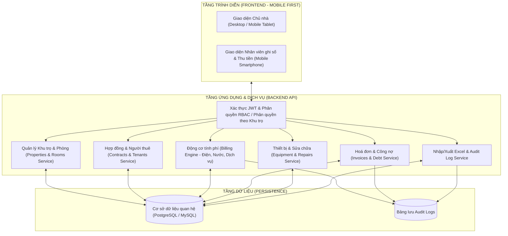
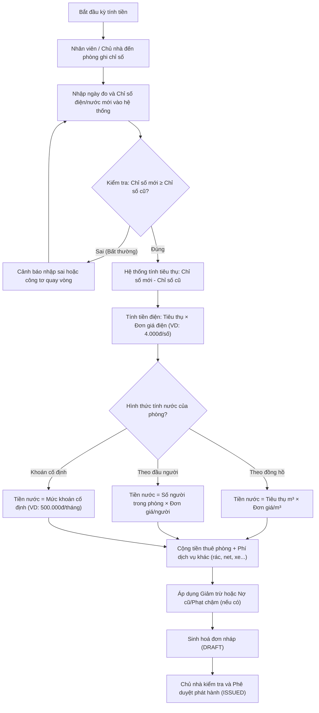
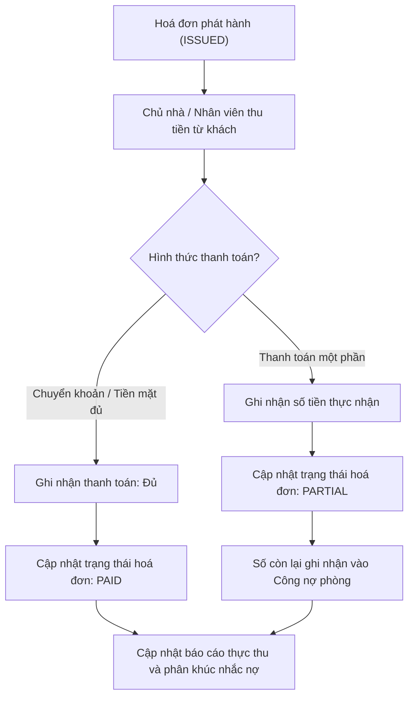
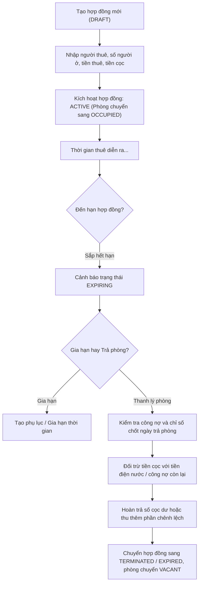
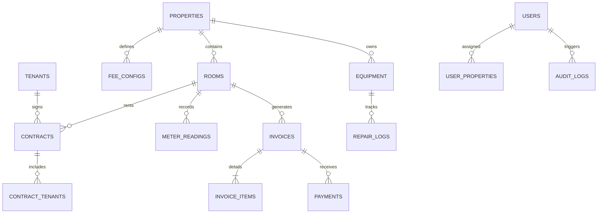

# ĐẶC TẢ YÊU CẦU PHẦN MỀM (SRS)
## Software Requirements Specification
### Rental Property Management System – Hệ thống quản lý phòng trọ và nhà cho thuê

- **Phiên bản:** 2.0 – Bản cập nhật theo BRD mới
- **Ngày lập:** 06/11/2026
- **Tác giả:** Nguyễn Huy Hoàng
- **Tài liệu đầu vào:** BRD – Hệ thống quản lý nhà cho thuê (Rental Property Management System), phiên bản ngày 06/11/2026.
- **Mục đích:** Chuyển hoá các yêu cầu nghiệp vụ trong BRD thành đặc tả yêu cầu phần mềm chi tiết, phục vụ thiết kế cơ sở dữ liệu, API, giao diện người dùng và kịch bản kiểm thử.

> **Quy ước mã hiệu:**
> - `FR-xxx`: Yêu cầu chức năng (Functional Requirements).
> - `NFR-xxx`: Yêu cầu phi chức năng (Non-Functional Requirements).
> - `RULE-xxx`: Quy tắc nghiệp vụ (Business Rules).
> - `AC-xxx`: Tiêu chí nghiệm thu (Acceptance Criteria).

---

# 1. GIỚI THIỆU (INTRODUCTION)

## 1.1. Mục đích tài liệu
Tài liệu SRS này đặc tả chi tiết các yêu cầu kỹ thuật và chức năng của **Rental Property Management System (RPMS)**, làm căn cứ chính thức cho:
- Thiết kế kiến trúc phần mềm và cơ sở dữ liệu quan hệ (ERD).
- Xây dựng giao diện người dùng (UI/UX) theo định hướng Mobile-First.
- Phát triển các dịch vụ Backend RESTful API và động cơ nghiệp vụ (Billing & Debt).
- Lập kế hoạch kiểm thử (Test Plan), kịch bản kiểm thử (Test Cases) và nghiệm thu phần mềm.

## 1.2. Phạm vi sản phẩm (Product Scope)
Hệ thống là ứng dụng Web Responsive tập trung hỗ trợ chủ nhà và người quản lý điều hành một hoặc nhiều khu trọ / nhà cho thuê, tập trung vào các nghiệp vụ cốt lõi:
- Quản lý danh mục khu trọ, phòng và dữ liệu người thuê.
- Quản lý hợp đồng thuê và tiền đặt cọc.
- Ghi nhận chỉ số điện nước theo ngày đo và tự động tính tiền điện theo số thực tế.
- Tính tiền nước linh hoạt theo 3 hình thức: theo chỉ số đồng hồ, theo số người ở, hoặc khoán cố định.
- Tự động lập hoá đơn dịch vụ theo kỳ, theo dõi thanh toán và công nợ.
- Lưu trữ lịch sử và chi phí sửa chữa thiết bị.
- Phân quyền vận hành tinh gọn giữa Chủ nhà (Owner) và Nhân viên thu phí (Staff).

### Danh sách các phân hệ chính:

| Mã phân hệ | Tên phân hệ | Mô tả ngắn gọn |
|---|---|---|
| **RPMS-01** | Quản trị Danh mục & Dữ liệu | Quản lý khu trọ, danh sách phòng, import dữ liệu từ Excel/CSV, chuẩn hoá dữ liệu |
| **RPMS-02** | Người thuê & Hợp đồng | Lưu thông tin người thuê, quản lý số người ở, vòng đời hợp đồng, tiền cọc |
| **RPMS-03** | Chỉ số & Động cơ tính phí (Billing Engine) | Ghi nhận chỉ số điện nước theo ngày đo, tính tiền điện theo số, tính tiền nước 3 hình thức |
| **RPMS-04** | Hoá đơn, Thanh toán & Công nợ (Debt Engine) | Tạo hoá đơn nháp, duyệt phát hành, ghi nhận thanh toán, theo dõi công nợ, nhắc nợ |
| **RPMS-05** | Thiết bị & Lịch sử sửa chữa | Danh mục thiết bị dùng chung/trong phòng, ghi nhận lịch sử và chi phí sửa chữa |
| **RPMS-06** | Phân quyền & Nhật ký (RBAC & Audit) | Quản lý tài khoản Owner/Staff, phân quyền theo khu trọ, ghi nhật ký thao tác |

## 1.3. Đối tượng sử dụng (Stakeholders & Users)

| Vai trò | Phân loại | Trách nhiệm & Quyền hạn chính |
|---|---|---|
| **Chủ nhà (Owner)** | Người dùng hệ thống (User) | Toàn quyền trên tất cả các khu trọ: cấu hình giá, quản lý phòng, hợp đồng, duyệt hoá đơn, xem báo cáo doanh thu/công nợ, quản lý tài khoản nhân viên. |
| **Nhân viên thu phí (Staff)** | Người dùng hệ thống (User) | Được phân công theo từng khu trọ cụ thể: ghi chỉ số điện nước tại phòng, ghi nhận thanh toán của khách, xem danh sách phòng và hoá đơn. Không có quyền sửa giá, xoá hoá đơn hay thay đổi hợp đồng. |
| **Người thuê (Tenant)** | **Dữ liệu quản lý (Master Data)** | **Không phải là tài khoản đăng nhập hệ thống.** Thông tin người thuê chỉ được lưu trữ để phục vụ lập hợp đồng, tính phí theo đầu người và đối soát công nợ. |

## 1.4. Định nghĩa và từ viết tắt

| Thuật ngữ | Ý nghĩa đầy đủ |
|---|---|
| **RPMS** | Rental Property Management System – Hệ thống quản lý nhà cho thuê / phòng trọ |
| **Property** | Khu trọ, toà nhà căn hộ mini hoặc nhà nguyên căn cho thuê |
| **Room** | Phòng trọ hoặc không gian cho thuê cụ thể có mã nhận diện riêng |
| **Master Data** | Dữ liệu danh mục nền tảng: khu trọ, phòng, thông tin người thuê, thiết bị, bảng giá |
| **Transactional Data** | Dữ liệu phát sinh theo giao dịch: hợp đồng, số đo điện nước, hoá đơn, phiếu thu, nhật ký sửa chữa |
| **Billing Engine** | Động cơ tự động tính toán chi phí và sinh hoá đơn theo kỳ |
| **Debt Engine** | Động cơ phân loại công nợ và theo dõi trạng thái thanh toán |
| **RBAC** | Role-Based Access Control – Phân quyền truy cập dựa trên vai trò |
| **Audit Log** | Nhật ký ghi nhận các thao tác chỉnh sửa dữ liệu quan trọng |

---

# 2. KIẾN TRÚC TỔNG THỂ & LUỒNG NGHIỆP VỤ

## 2.1. Kiến trúc hệ thống tổng quát
Hệ thống được thiết kế theo mô hình 3 tầng hiện đại, tối ưu hoá cho trải nghiệm người dùng di động (Mobile Web Responsive):

## 2.2. Các luồng nghiệp vụ cốt lõi

### 2.2.1. Luồng chốt chỉ số và tạo hoá đơn hằng tháng

### 2.2.2. Luồng thu tiền và quản lý công nợ

### 2.2.3. Luồng ký hợp đồng, thu cọc và hoàn trả khi thanh lý

---

# 3. ĐẶC TẢ YÊU CẦU CHỨC NĂNG (FUNCTIONAL REQUIREMENTS)

## 3.1. Phân hệ RPMS-01: Quản trị Danh mục & Dữ liệu

### FR-01.1: Quản lý Khu trọ / Nhà cho thuê (Properties)
- **Mô tả:** Cho phép Chủ nhà quản lý danh mục các bất động sản/khu trọ của mình.
- **Chi tiết:**
  - Tạo mới, cập nhật, ngừng hoạt động khu trọ.
  - Các thông tin: Mã khu trọ (duy nhất), Tên khu trọ, Địa chỉ, Số lượng phòng, Ghi chú.
  - Không cho phép xoá cứng khu trọ đã có phòng phát sinh hợp đồng hoặc hoá đơn.

### FR-01.2: Quản lý Phòng trọ (Rooms)
- **Mô tả:** Quản lý chi tiết từng phòng trọ thuộc khu trọ.
- **Chi tiết:**
  - Thông tin phòng gồm: Mã phòng (VD: `KT01-P01`, duy nhất trong toàn hệ thống), Tên phòng, Tầng, Diện tích (m²), Tiền thuê cơ bản chuẩn/tháng.
  - **Cấu hình hình thức quản lý số người:** `has_occupant_tracking` (Bật/Tắt).
    - Nếu Bật: Phòng quản lý số người ở thực tế (phục vụ mô hình phòng trọ).
    - Nếu Tắt: Không bắt buộc đếm người (phục vụ phòng cho công ty/văn phòng thuê).
  - **Trạng thái phòng:** 
    - `VACANT`: Phòng trống, sẵn sàng cho thuê.
    - `OCCUPIED`: Đang có người thuê (đang gắn với 1 hợp đồng `ACTIVE`).
    - `MAINTENANCE`: Đang sửa chữa, tạm ngưng khai thác.

### FR-01.3: Quản lý thông tin Người thuê (Tenants Master Data)
- **Mô tả:** Lưu trữ thông tin cá nhân của người thuê để làm căn cứ pháp lý và liên lạc.
- **Chi tiết:**
  - Lưu: Họ tên, Số điện thoại (chuẩn hoá 10 chữ số), Số CCCD/CMND, Ngày sinh, Quê quán, Ảnh chụp CCCD (tuỳ chọn).
  - Một người thuê có thể là người đứng tên chính trong hợp đồng hoặc là thành viên ở cùng.
  - Hỗ trợ tra cứu nhanh lịch sử thuê phòng và lịch sử thanh toán của người thuê theo số điện thoại/CCCD.

### FR-01.4: Import / Export dữ liệu Excel
- **Mô tả:** Cho phép chủ nhà đưa dữ liệu từ Excel vào hệ thống để bắt đầu sử dụng nhanh.
- **Chi tiết:**
  - Hỗ trợ tải file mẫu Excel (.xlsx, .csv).
  - Import danh sách phòng và danh sách người thuê.
  - **Xử lý lỗi import:** Kiểm tra tính hợp lệ của từng dòng. Nếu có lỗi, hiển thị rõ số dòng, cột lỗi và nguyên nhân cụ thể (ví dụ: trùng mã phòng, định dạng ngày sai, tiền không phải số nguyên). Không tự động import một phần âm thầm.
  - Export danh sách phòng, danh sách công nợ và hoá đơn ra file Excel.

### FR-01.5: Chuẩn hoá dữ liệu (Normalization)
- **Mô tả:** Đảm bảo toàn vẹn dữ liệu nhập từ giao diện hoặc file.
- **Quy tắc:**
  - Định dạng ngày tháng: `YYYY-MM-DD`.
  - Tiền tệ: Số nguyên dương (VNĐ). Chuyển đổi các định dạng nhập như `1.200.000`, `1,200,000`, `1200k` thành `1200000`.
  - Mã phòng: Viết hoa không dấu, không chứa khoảng trắng (VD: `P101`, `KT02-P301`).

---

## 3.2. Phân hệ RPMS-02: Quản lý Hợp đồng & Tiền cọc

### FR-02.1: Quản lý Vòng đời Hợp đồng thuê
- **Mô tả:** Theo dõi toàn bộ vòng đời của hợp đồng thuê phòng.
- **Các trạng thái:**
  - `DRAFT`: Hợp đồng nháp đang lập.
  - `ACTIVE`: Hợp đồng đang có hiệu lực. Phòng tự động chuyển sang `OCCUPIED`.
  - `EXPIRING`: Hợp đồng sắp hết hạn (nằm trong khoảng cảnh báo trước N ngày do chủ nhà cấu hình, mặc định 15 ngày).
  - `EXPIRED`: Hợp đồng đã đến hạn kết thúc mà chưa gia hạn.
  - `TERMINATED`: Đã thanh lý, hoàn tất đối trừ công nợ và trả phòng. Phòng tự động chuyển sang `VACANT`.
- **Ràng buộc:** Tại một thời điểm, mỗi phòng chỉ được phép có **tối đa một** hợp đồng ở trạng thái `ACTIVE` (Quy tắc RULE-02).

### FR-02.2: Quản lý số người ở trong hợp đồng
- **Mô tả:** Gắn danh sách người ở thực tế vào hợp đồng thuê.
- **Chi tiết:**
  - Gắn người thuê chính (đại diện ký hợp đồng).
  - Khai báo danh sách người ở cùng (Họ tên, SĐT, CCCD) hoặc nhập trường **Số người ở thực tế** (occupant count).
  - Đối với phòng có bật `has_occupant_tracking`, trường số người ở là bắt buộc (tối thiểu là 1) để làm căn cứ tính tiền nước theo đầu người.

### FR-02.3: Quản lý Tiền đặt cọc (Deposit Management)
- **Mô tả:** Quản lý tiền cọc khi khách vào ở và xử lý cọc khi trả phòng.
- **Chi tiết:**
  - Ghi nhận số tiền đặt cọc khi tạo hợp đồng và ngày thu cọc.
  - Trạng thái cọc: `HELD` (đang giữ cọc), `DEDUCTED` (đã đối trừ vào công nợ), `REFUNDED` (đã hoàn trả khách).
  - **Nghiệp vụ thanh lý hợp đồng:** Hệ thống cung cấp bảng tính đối soát thanh lý:
    $$\text{Tiền trả lại khách} = \text{Tiền cọc} - \text{Nợ hoá đơn cũ} - \text{Tiền điện nước kỳ cuối} - \text{Phí hư hỏng (nếu có)}$$
  - Bắt buộc ghi nhận lý do nếu có trừ cọc do hư hỏng thiết bị hoặc vi phạm hợp đồng.

---

## 3.3. Phân hệ RPMS-03: Ghi nhận Chỉ số & Động cơ tính phí (Billing Engine)

### FR-03.1: Cấu hình Bảng giá Dịch vụ (Fee Rules)
- **Mô tả:** Chủ nhà cấu hình giá các dịch vụ áp dụng cho từng khu trọ hoặc áp dụng riêng cho từng phòng.
- **Chi tiết:**
  - **Đơn giá điện:** Đơn giá cố định trên 1 số điện (kWh), ví dụ: 3.500đ, 4.000đ/số.
  - **Đơn giá nước:** Cấu hình theo hình thức tính áp dụng cho phòng:
    + Đơn giá theo khối nước (m³).
    + Đơn giá theo đầu người / tháng (VD: 80.000đ, 100.000đ/người/tháng).
    + Mức giá khoán cố định theo tháng (VD: 300.000đ, 500.000đ/tháng).
  - **Dịch vụ khác:** Phí rác, Phí Internet/Wifi, Phí gửi xe máy (theo đầu xe), Phí vệ sinh chung... Có thể cấu hình tính theo phòng, theo đầu người hoặc theo đầu xe.
  - Bảng giá có ngày bắt đầu hiệu lực. Hoá đơn kỳ nào áp dụng bảng giá có hiệu lực tại kỳ đó.

### FR-03.2: Ghi nhận Chỉ số Điện nước theo ngày đo
- **Mô tả:** Giao diện nhập chỉ số nhanh, tối ưu trên điện thoại cho người đi ghi chỉ số thực tế.
- **Chi tiết:**
  - Mỗi bản ghi chỉ số gồm: Phòng, Loại công tơ (Điện / Nước), Ngày đo kỳ trước, Chỉ số kỳ trước, Ngày đo kỳ này, Chỉ số kỳ này, Người ghi nhận.
  - **Tự động điền:** Khi mở form ghi chỉ số, hệ thống tự động tải chỉ số và ngày đo của kỳ liền trước làm "Chỉ số kỳ trước".
  - **Kiểm tra tính hợp lệ:** 
    - Chỉ số kỳ này phải $\ge$ Chỉ số kỳ trước (RULE-03).
    - Trường hợp thay công tơ: Cho phép đánh dấu cờ "Đổi công tơ", yêu cầu nhập chỉ số chốt của công tơ cũ và chỉ số bắt đầu của công tơ mới kèm ghi chú.
  - **Cảnh báo bất thường:** Nếu mức tiêu thụ tăng vọt bất thường (> 150% so với mức trung bình 2 kỳ gần nhất), hiển thị cảnh báo màu vàng để người ghi kiểm tra lại công tơ trước khi lưu.

### FR-03.3: Động cơ tính tiền điện theo số thực tế
- **Mô tả:** Tự động tính tiền điện theo số tiêu thụ giữa 2 ngày đo.
- **Công thức:**
  $$\text{Số điện tiêu thụ} = \text{Chỉ số điện kỳ này} - \text{Chỉ số điện kỳ trước}$$
  $$\text{Tiền điện} = \text{Số điện tiêu thụ} \times \text{Đơn giá 1 số điện}$$
- **Ví dụ kiểm thử:** Chỉ số cũ ngày 05/10 là 1.000; Chỉ số mới ngày 05/11 là 1.030 $\rightarrow$ Tiêu thụ = 30 số. Với đơn giá 4.000 VNĐ/số $\rightarrow$ Tiền điện = $30 \times 4.000 = 120.000$ VNĐ.

### FR-03.4: Động cơ tính tiền nước linh hoạt (3 hình thức)
- **Mô tả:** Tính tiền nước căn cứ theo cấu hình của từng phòng/hợp đồng:
  - **Hình thức 1 (Theo chỉ số đồng hồ nước):**
    $$\text{Số khối nước tiêu thụ} = \text{Chỉ số nước mới} - \text{Chỉ số nước cũ}$$
    $$\text{Tiền nước} = \text{Số khối nước tiêu thụ} \times \text{Đơn giá 1 khối (m³)}$$
  - **Hình thức 2 (Theo số lượng người ở - mô hình phòng trọ):**
    $$\text{Tiền nước} = \text{Số người ở trong phòng} \times \text{Đơn giá nước / người / tháng}$$
    *(Ví dụ: Phòng có 3 người, đơn giá 100.000 VNĐ/người $\rightarrow$ Tiền nước = $3 \times 100.000 = 300.000$ VNĐ/tháng).*
  - **Hình thức 3 (Khoán cố định theo tháng - mô hình công ty/văn phòng thuê):**
    $$\text{Tiền nước} = \text{Đơn giá khoán cố định theo tháng thoả thuận trong hợp đồng}$$
    *(Ví dụ: Công ty thuê văn phòng khoán 500.000 VNĐ/tháng không phụ thuộc số người hay số đo).*

---

## 3.4. Phân hệ RPMS-04: Hoá đơn, Thanh toán & Công nợ (Debt Engine)

### FR-04.1: Quy trình sinh Hoá đơn dịch vụ theo kỳ (Billing Pipeline)
- **Mô tả:** Tự động tổng hợp các khoản phí để tạo hoá đơn hàng tháng cho từng phòng.
- **Các bước thực hiện:**
  1. Kiểm tra phòng đã có đủ chỉ số điện nước hợp lệ của kỳ.
  2. Lấy tiền thuê phòng cố định theo hợp đồng (tính tròn tháng hoặc tính theo số ngày thực tế nếu vào/ra giữa tháng).
  3. Tính tiền điện theo FR-03.3.
  4. Tính tiền nước theo hình thức tương ứng của phòng (FR-03.4).
  5. Tính các khoản phí dịch vụ khác (wifi, rác, xe máy).
  6. Cộng dồn nợ cũ chưa thanh toán từ kỳ trước (nếu có).
  7. Trừ các khoản giảm trừ khuyến mãi (nếu có).
  8. Sinh hoá đơn ở trạng thái **`DRAFT`** (Nháp).
- **Tổng tiền hoá đơn:**
  $$\text{Tổng tiền} = \text{Tiền thuê} + \text{Tiền điện} + \text{Tiền nước} + \text{Phí dịch vụ} + \text{Nợ cũ} - \text{Giảm trừ} + \text{Phạt chậm (nếu có)}$$

### FR-04.2: Phê duyệt và Phát hành Hoá đơn
- **Mô tả:** Chủ nhà xem xét chi tiết hoá đơn nháp trước khi gửi thông báo cho khách.
- **Chi tiết:**
  - Chủ nhà kiểm tra danh sách hoá đơn `DRAFT`, xem chi tiết từng dòng mục (itemized bill).
  - Phê duyệt đơn lẻ hoặc phê duyệt hàng loạt theo khu trọ $\rightarrow$ Hoá đơn chuyển sang trạng thái **`ISSUED`** (Đã phát hành).
  - **Quy tắc bất biến (RULE-04):** Hoá đơn đã ở trạng thái `ISSUED` không được phép xoá. Mọi sự thay đổi phải thực hiện qua chức năng "Điều chỉnh hoá đơn" (ghi rõ lý do điều chỉnh và người duyệt).

### FR-04.3: Ghi nhận Thanh toán (Payments)
- **Mô tả:** Ghi nhận tiền khách trả khi thu trực tiếp hoặc qua chuyển khoản ngân hàng.
- **Chi tiết:**
  - Nhân viên hoặc Chủ nhà tìm kiếm theo phòng $\rightarrow$ Chọn hoá đơn cần thu.
  - Nhập: Số tiền thực thu, Ngày thanh toán, Hình thức (Tiền mặt / Chuyển khoản), Ghi chú.
  - **Xử lý trạng thái hoá đơn:**
    - Nếu Số tiền thu $\ge$ Tổng tiền phải trả: Hoá đơn chuyển sang **`PAID`** (Đã thanh toán đủ).
    - Nếu $0 < \text{Số tiền thu} < \text{Tổng tiền phải trả}$: Hoá đơn chuyển sang **`PARTIAL`** (Thanh toán một phần). Phần tiền còn thiếu được lưu trữ vào công nợ tồn đọng của phòng.
  - Cho phép xuất phiếu thu hoặc chia sẻ ảnh hoá đơn / tin nhắn tổng hợp qua Zalo, tin nhắn SMS cho khách.

### FR-04.4: Theo dõi Công nợ & Phân khúc thanh toán (Debt Engine)
- **Mô tả:** Quản lý danh sách các phòng còn nợ và phân loại hành vi nợ.
- **Chi tiết:**
  - Thống kê tổng công nợ theo từng phòng và theo từng khu trọ.
  - Phân loại phòng theo 5 phân khúc:
    1. *Đúng hạn:* Luôn trả đủ trước ngày hạn thanh toán.
    2. *Trễ thỉnh thoảng:* Trễ dưới 5 ngày, thanh toán sau khi nhắc.
    3. *Trễ thường xuyên:* Trễ trên 5 ngày liên tục qua nhiều tháng.
    4. *Nợ kéo dài:* Nợ gối đầu qua hơn 1 kỳ hoá đơn $\rightarrow$ Cảnh báo đỏ nổi bật trên màn hình để chủ nhà có biện pháp xử lý.
    5. *Người thuê mới:* Chưa có đủ lịch sử thanh toán 2 kỳ.

---

## 3.5. Phân hệ RPMS-05: Thiết bị & Lịch sử Sửa chữa

### FR-05.1: Danh mục Thiết bị (Equipment)
- **Mô tả:** Theo dõi tài sản, trang thiết bị trong từng phòng và khu vực dùng chung.
- **Chi tiết:**
  - Khai báo thiết bị: Máy bơm nước, Bình nóng lạnh, Điều hoà, Cửa cuốn, Bồn nước, Hệ thống đèn/quạt, Tủ lạnh...
  - Gắn vị trí: Thuộc khu vực chung của khu trọ (Khu giặt, Cổng chính...) hoặc nằm trong phòng cụ thể (Phòng 102).
  - Lưu thông tin: Mã thiết bị, Tên thiết bị, Hãng/Nhà cung cấp, Ngày lắp đặt, Giá trị mua ban đầu.

### FR-05.2: Ghi nhận Nhật ký Sửa chữa (Repair Logs)
- **Mô tả:** Lưu lại lịch sử mỗi lần thiết bị gặp sự cố và được sửa chữa.
- **Chi tiết:**
  - Nhập bản ghi sửa chữa: Chọn thiết bị, Ngày sửa, Người/Thợ sửa chữa, Nội dung hỏng hóc & giải pháp xử lý, Chi phí sửa chữa (VNĐ), Người thanh toán (Chủ nhà chịu hoặc Trừ vào người thuê nếu do người thuê làm hỏng).
  - Tự động cộng dồn **Chi phí sửa chữa luỹ kế** cho từng thiết bị.

### FR-05.3: Cảnh báo Thiết bị hỏng lặp lại
- **Mô tả:** Hỗ trợ chủ nhà ra quyết định thay mới thiết bị.
- **Chi tiết:**
  - Nếu một thiết bị phát sinh $\ge 3$ lần sửa chữa trong vòng 6 tháng: Hệ thống gắn nhãn cảnh báo **"Cân nhắc thay mới"**.
  - Hiển thị so sánh: Tổng chi phí đã sửa chữa so với giá trị mua mới của thiết bị.

---

## 3.6. Phân hệ RPMS-06: Phân quyền & Nhật ký (RBAC & Audit)

### FR-06.1: Quản lý Tài khoản & Phân quyền 2 vai trò
- **Mô tả:** Phân quyền kiểm soát truy cập chặt chẽ giữa Chủ nhà và Nhân viên.
- **Ma trận phân quyền:**

| Chức năng nghiệp vụ | Chủ nhà (Owner) | Nhân viên thu phí (Staff) |
|---|:---:|:---:|
| Tạo / Sửa khu trọ & Bảng giá dịch vụ | Toàn quyền | Không có quyền |
| Quản lý phòng & Hợp đồng thuê | Toàn quyền | Chỉ xem |
| Nhập chỉ số điện nước | Toàn quyền | Được làm (chỉ khu trọ được giao) |
| Lập & Duyệt hoá đơn | Toàn quyền | Không có quyền |
| Ghi nhận thanh toán & Thu tiền | Toàn quyền | Được làm (chỉ khu trọ được giao) |
| Xem báo cáo doanh thu & công nợ | Xem tất cả | Chỉ xem khu trọ được giao |
| Quản lý thiết bị & Ghi nhận sửa chữa | Toàn quyền | Được nhập sửa chữa |
| Quản lý tài khoản nhân viên | Toàn quyền | Không có quyền |

### FR-06.2: Giới hạn phạm vi dữ liệu theo Khu trọ
- **Mô tả:** Nhân viên chỉ có thể thấy và thao tác với các phòng thuộc khu trọ mà chủ nhà đã phân công.
- **Quy tắc máy chủ:** Mọi API gọi từ tài khoản Staff đều phải được kiểm tra ràng buộc `user_properties` ở tầng Backend, không dựa vào việc ẩn nút trên giao diện.

### FR-06.3: Nhật ký thao tác (Audit Trail)
- **Mô tả:** Lưu vết các thao tác nhạy cảm liên quan đến tiền bạc và hợp đồng.
- **Chi tiết:**
  - Ghi log tự động khi: Điều chỉnh hoá đơn đã phát hành, Thay đổi trạng thái hợp đồng (kích hoạt/thanh lý), Thay đổi bảng giá, Điều chỉnh công nợ.
  - Thông tin lưu trữ: ID người thao tác, Thời điểm phát sinh (timestamp), Hành động (CREATE, UPDATE, DELETE), Giá trị trước (Before Value), Giá trị sau (After Value).
  - Nhật ký không thể bị chỉnh sửa hoặc xoá bởi bất kỳ người dùng nào qua giao diện.

---

# 4. YÊU CẦU GIAO DIỆN NGƯỜI DÙNG (USER INTERFACE REQUIREMENTS)

> **Ghi chú về thiết kế:** Hệ thống không áp đặt bố cục giao diện cố định hoặc chi tiết từng nút bấm trong tài liệu này. Thay vào đó, tài liệu xác định các **nguyên tắc thiết kế** và **danh mục màn hình nghiệp vụ cần thiết kế**. Công cụ thiết kế UI chuyên dụng (như **Google Stitch**) sẽ tự do sáng tạo, bố trí giao diện và xây dựng các luồng tương tác tối ưu nhất dựa trên toàn bộ yêu cầu nghiệp vụ (Mục 3) và mô hình dữ liệu (Mục 5).

---

## 4.1. Nguyên tắc thiết kế chung (Design Principles)

1. **Định hướng Mobile-First:**
   - Hệ thống chủ yếu được Chủ nhà và Nhân viên sử dụng trên điện thoại di động khi trực tiếp đi đến từng phòng trọ để ghi chỉ số điện nước hoặc thu tiền.
   - Giao diện phải tối ưu cho thao tác chạm (touch-friendly), khoảng cách giữa các phần tử đủ lớn để không bấm nhầm, ô nhập số tự động bật bàn phím số (numeric keypad).

2. **Trực quan hoá trạng thái phòng (Visual Room Status):**
   - Danh sách phòng cần được thể hiện bằng màu sắc hoặc nhãn rõ ràng để người dùng nhận biết ngay lập tức:
     - Phòng đang thuê & đã thanh toán đầy đủ.
     - Phòng đang thuê & chưa chốt điện nước hoặc đang nợ tiền.
     - Phòng trống sẵn sàng cho thuê.
     - Phòng đang sửa chữa/bảo trì.

3. **Tối ưu tốc độ thao tác (Speed & Usability):**
   - Quy trình ghi chỉ số điện nước phải liền mạch, hỗ trợ chuyển phòng kế tiếp nhanh chóng mà không cần quay lại màn hình danh sách nhiều lần.
   - Thao tác ghi nhận thanh toán nhanh gọn, hỗ trợ hiển thị mã QR thanh toán ngân hàng (VietQR).

4. **Ngôn ngữ & Thuật ngữ:**
   - 100% tiếng Việt, sử dụng các thuật ngữ quen thuộc với chủ trọ (số điện, số nước, tiền cọc, nợ cũ, phòng trống...).

---

## 4.2. Danh mục màn hình nghiệp vụ & Tệp giao diện HTML do Stitch tự động sinh

Các màn hình dưới đây đã được **Google Stitch AI tự động thiết kế và kết xuất mã HTML trực tiếp** từ tài liệu SRS này:

| Mã màn hình | Tên màn hình nghiệp vụ | Tệp giao diện HTML từ Stitch | Ảnh chụp thiết kế (Screenshot) | Mã Screen ID trên Stitch |
|---|---|---|---|---|
| **SCR-02** | **Quản lý Danh sách Phòng trọ** | [quan_ly_phong_tro.html](file:///d:/My_Project/building-management-system/docs/stitch_screens/quan_ly_phong_tro.html) | [quan_ly_phong_tro.png](file:///d:/My_Project/building-management-system/docs/stitch_screens/quan_ly_phong_tro.png) | `e52ed83f87dc4dc1a6ad1058b7833a74` |
| **SCR-03** | **Ghi nhận Chỉ số Điện Nước** | [ghi_chi_so_dien_nuoc.html](file:///d:/My_Project/building-management-system/docs/stitch_screens/ghi_chi_so_dien_nuoc.html) | [ghi_chi_so_dien_nuoc.png](file:///d:/My_Project/building-management-system/docs/stitch_screens/ghi_chi_so_dien_nuoc.png) | `73aaacffb3a444baa18bdb549a23919f` |
| **SCR-04** | **Chi tiết Hoá đơn & Thu tiền** | [hoa_don_thu_tien.html](file:///d:/My_Project/building-management-system/docs/stitch_screens/hoa_don_thu_tien.html) | [hoa_don_thu_tien.png](file:///d:/My_Project/building-management-system/docs/stitch_screens/hoa_don_thu_tien.png) | `71d11d2cfe84497aae609b613ffc4123` |
| **SCR-01** | **Đăng nhập & Chọn Khu trọ** | *(Sẵn sàng tự sinh)* | - | - |
| **SCR-05** | **Hợp đồng & Tiền đặt cọc** | *(Sẵn sàng tự sinh)* | - | - |
| **SCR-06** | **Thiết bị & Nhật ký Sửa chữa** | *(Sẵn sàng tự sinh)* | - | - |
| **SCR-07** | **Báo cáo Doanh thu & Công nợ** | *(Sẵn sàng tự sinh)* | - | - |

> 💡 **Cách xem:** Bạn có thể mở trực tiếp các tệp `.html` trong thư mục `docs/stitch_screens/` bằng bất kỳ trình duyệt nào để xem và thao tác thử với giao diện nguyên bản do Google Stitch thiết kế!

---

## 4.3. Tiêu chí nghiệm thu thiết kế UI (Design Acceptance Criteria)

Một bản thiết kế giao diện (được tạo bởi Stitch hoặc UI Designer) được coi là hợp lệ khi đáp ứng đầy đủ các tiêu chí sau:
1. **Tính đầy đủ:** Có đủ các trường dữ liệu và nghiệp vụ đã quy định trong Mục 3 (FR-01.1 đến FR-06.3) và Mục 5 (Mô hình dữ liệu).
2. **Hỗ trợ 2 vai trò:** Giao diện cho phép phân biệt phạm vi thao tác của Chủ nhà (Owner - toàn quyền) và Nhân viên (Staff - chỉ ghi số, thu tiền theo khu trọ được giao).
3. **Phù hợp thực tế:** Thể hiện đúng quy tắc điện tính theo số thực tế nhân đơn giá, nước linh hoạt 3 dạng (đồng hồ / đầu người / khoán), phòng có hoặc không quản lý số người.

---

# 5. MÔ HÌNH DỮ LIỆU LOGIC (DATA MODEL)

## 5.1. Bảng dữ liệu chính

### 5.2. Đặc tả các trường dữ liệu tiêu biểu

#### 1. Bảng `properties` (Khu trọ / Nhà cho thuê)
- `id`: BIGSERIAL (Primary Key)
- `property_code`: VARCHAR(50) (Unique - Mã khu trọ, VD: `KT-01`)
- `name`: VARCHAR(255) (Tên khu trọ)
- `address`: TEXT (Địa chỉ)
- `owner_id`: BIGINT (Foreign Key -> `users.id`)
- `status`: VARCHAR(20) (`ACTIVE`, `INACTIVE`)
- `created_at`: TIMESTAMP

#### 2. Bảng `rooms` (Phòng trọ)
- `id`: BIGSERIAL (Primary Key)
- `property_id`: BIGINT (Foreign Key -> `properties.id`)
- `room_code`: VARCHAR(50) (Unique toàn hệ thống - Mã phòng, VD: `KT01-P101`)
- `floor`: INT (Tầng)
- `area`: NUMERIC(6, 2) (Diện tích m²)
- `base_price`: BIGINT (Giá thuê tiêu chuẩn VNĐ)
- `has_occupant_tracking`: BOOLEAN (True: Có quản lý số người; False: Không quản lý số người)
- `water_billing_type`: VARCHAR(20) (`BY_METER`, `BY_OCCUPANT`, `FLAT_MONTHLY`)
- `status`: VARCHAR(20) (`VACANT`, `OCCUPIED`, `MAINTENANCE`)

#### 3. Bảng `tenants` (Người thuê)
- `id`: BIGSERIAL (Primary Key)
- `full_name`: VARCHAR(255) (Họ và tên)
- `phone`: VARCHAR(20) (Số điện thoại)
- `identity_card`: VARCHAR(30) (Số CCCD/CMND)
- `birth_date`: DATE
- `hometown`: VARCHAR(255) (Quê quán)
- `created_at`: TIMESTAMP

#### 4. Bảng `contracts` (Hợp đồng thuê)
- `id`: BIGSERIAL (Primary Key)
- `contract_code`: VARCHAR(50) (Unique)
- `room_id`: BIGINT (Foreign Key -> `rooms.id`)
- `primary_tenant_id`: BIGINT (Foreign Key -> `tenants.id`)
- `start_date`: DATE (Ngày bắt đầu)
- `end_date`: DATE (Ngày kết thúc)
- `monthly_rent`: BIGINT (Tiền thuê thoả thuận / tháng)
- `deposit_amount`: BIGINT (Tiền đặt cọc)
- `deposit_status`: VARCHAR(20) (`HELD`, `DEDUCTED`, `REFUNDED`)
- `occupant_count`: INT (Số lượng người ở thực tế)
- `status`: VARCHAR(20) (`DRAFT`, `ACTIVE`, `EXPIRING`, `EXPIRED`, `TERMINATED`)

#### 5. Bảng `meter_readings` (Chỉ số công tơ điện nước)
- `id`: BIGSERIAL (Primary Key)
- `room_id`: BIGINT (Foreign Key -> `rooms.id`)
- `meter_type`: VARCHAR(10) (`ELECTRICITY`, `WATER`)
- `billing_period`: VARCHAR(7) (Định dạng: `YYYY-MM`)
- `previous_date`: DATE (Ngày đo kỳ trước)
- `previous_value`: NUMERIC(10, 2) (Chỉ số cũ)
- `reading_date`: DATE (Ngày đo kỳ này)
- `current_value`: NUMERIC(10, 2) (Chỉ số mới)
- `consumption`: NUMERIC(10, 2) (Số tiêu thụ = current - previous)
- `recorded_by`: BIGINT (Foreign Key -> `users.id`)
- `notes`: TEXT

#### 6. Bảng `invoices` (Hoá đơn dịch vụ)
- `id`: BIGSERIAL (Primary Key)
- `invoice_no`: VARCHAR(50) (Unique, VD: `INV-202611-P101`)
- `room_id`: BIGINT (Foreign Key -> `rooms.id`)
- `contract_id`: BIGINT (Foreign Key -> `contracts.id`)
- `billing_period`: VARCHAR(7) (`YYYY-MM`)
- `issue_date`: DATE (Ngày phát hành)
- `due_date`: DATE (Hạn thanh toán)
- `room_amount`: BIGINT (Tiền phòng)
- `electricity_amount`: BIGINT (Tiền điện)
- `water_amount`: BIGINT (Tiền nước)
- `services_amount`: BIGINT (Tổng tiền các dịch vụ khác)
- `discount_amount`: BIGINT (Giảm trừ)
- `debt_carried_over`: BIGINT (Nợ cũ chuyển sang)
- `total_amount`: BIGINT (Tổng số tiền phải thanh toán)
- `paid_amount`: BIGINT (Số tiền đã thanh toán)
- `status`: VARCHAR(20) (`DRAFT`, `ISSUED`, `PARTIAL`, `PAID`, `CANCELLED`)

#### 7. Bảng `payments` (Lịch sử thanh toán)
- `id`: BIGSERIAL (Primary Key)
- `invoice_id`: BIGINT (Foreign Key -> `invoices.id`)
- `amount`: BIGINT (Số tiền nộp)
- `payment_date`: TIMESTAMP (Thời điểm thanh toán)
- `payment_method`: VARCHAR(20) (`CASH`, `BANK_TRANSFER`)
- `received_by`: BIGINT (Foreign Key -> `users.id`)
- `notes`: TEXT

#### 8. Bảng `equipment` & `repair_logs` (Thiết bị & Sửa chữa)
- `equipment`: `id`, `property_id`, `room_id` (NULL nếu là khu chung), `equipment_code`, `name`, `installed_date`, `initial_cost`
- `repair_logs`: `id`, `equipment_id`, `repair_date`, `repair_man`, `description`, `cost`, `paid_by` (`OWNER`, `TENANT`), `created_by`

#### 9. Bảng `users`, `user_properties` & `audit_logs` (Phân quyền & Nhật ký)
- `users`: `id`, `username`, `password_hash`, `full_name`, `phone`, `role` (`OWNER`, `STAFF`), `status`
- `user_properties`: `user_id`, `property_id`
- `audit_logs`: `id`, `user_id`, `action`, `entity_type`, `entity_id`, `before_value` (JSON), `after_value` (JSON), `created_at`

---

# 6. QUY TẮC NGHIỆP VỤ (BUSINESS RULES)

| Mã quy tắc | Tên quy tắc | Mô tả chi tiết thực thi trong hệ thống |
|---|---|---|
| **RULE-01** | **Doanh thu thực thu** | Doanh thu thực tế chỉ được ghi nhận từ tổng số tiền trong các bản ghi `payments` của hoá đơn `PAID` hoặc `PARTIAL`. Hoá đơn ở trạng thái `DRAFT` và `CANCELLED` không được tính vào doanh thu. |
| **RULE-02** | **Một hợp đồng hiệu lực** | Mỗi phòng trọ chỉ có duy nhất một hợp đồng ở trạng thái `ACTIVE` tại một thời điểm. Không cho phép kích hoạt hợp đồng mới nếu phòng đang có hợp đồng `ACTIVE`. |
| **RULE-03** | **Chỉ số công tơ & Ngày đo** | Chỉ số mới phải $\ge$ Chỉ số cũ. Mỗi bản ghi chỉ số phải lưu ngày đo thực tế. Trường hợp đổi công tơ phải chốt công tơ cũ và ghi nhận số bắt đầu của công tơ mới kèm lý do. |
| **RULE-04** | **Bất biến hoá đơn** | Hoá đơn đã ở trạng thái `ISSUED` không được phép xoá vật lý khỏi cơ sở dữ liệu. Mọi sửa đổi phải thực hiện bằng bút toán điều chỉnh kèm lý do và ghi nhận audit log. |
| **RULE-05** | **Bảng giá theo hiệu lực** | Hoá đơn tính phí cho kỳ nào phải lấy bảng giá có hiệu lực tại kỳ tính phí đó, không áp dụng bảng giá mới tạo cho các kỳ cũ đã phát hành. |
| **RULE-06** | **Phạt chậm thanh toán** | Chỉ được tính sau ngày đến hạn thanh toán (`due_date`) theo tỷ lệ thoả thuận trong hợp đồng và không vượt quá giới hạn pháp luật quy định. |
| **RULE-07** | **Đối soát tiền cọc** | Tiền đặt cọc được ghi nhận riêng khi lập hợp đồng. Khi thanh lý, tiền cọc được ưu tiên cấn trừ vào công nợ tồn đọng hoặc phí hư hỏng trước khi hoàn tiền thừa cho khách. Mọi thao tác đối trừ cọc phải lưu vết audit log. |
| **RULE-08** | **Bảo mật dữ liệu theo phạm vi** | Chủ nhà (Owner) xem toàn bộ các khu trọ thuộc quyền sở hữu của mình. Nhân viên (Staff) chỉ được truy cập dữ liệu của các khu trọ được gán trong bảng `user_properties`. |

---

# 7. YÊU CẦU PHI CHỨC NĂNG (NON-FUNCTIONAL REQUIREMENTS)

## 7.1. Khả dụng & Trải nghiệm (NFR-USAB)
- **NFR-USAB-01:** Giao diện hoàn toàn bằng tiếng Việt, thuật ngữ quản lý phòng trọ chuẩn xác, gần gũi.
- **NFR-USAB-02 (Tối ưu thao tác mobile):** Màn hình ghi chỉ số điện nước phải cho phép người dùng thao tác nhập số mới và bấm chuyển sang phòng tiếp theo trong vòng dưới 5 giây mỗi phòng.
- **NFR-USAB-03:** Hoạt động mượt mà và tương thích tốt trên các trình duyệt di động phổ biến (Chrome, Safari trên Android & iOS).

## 7.2. Bảo mật & Xác thực (NFR-SEC)
- **NFR-SEC-01:** Mật khẩu tài khoản phải được mã hoá bằng thuật toán băm an toàn (BCrypt hoặc Argon2), không lưu mật khẩu dạng bản rõ.
- **NFR-SEC-02:** Xác thực API thông qua chuẩn JSON Web Token (JWT) có thời hạn hiệu lực rõ ràng.
- **NFR-SEC-03:** Kiểm soát phân quyền (Authorization) chặt chẽ ở tầng Backend: Mọi request từ tài khoản Staff đều phải kiểm tra quyền hạn với `property_id` tương ứng, ngăn chặn tuyệt đối việc truy cập trái phép bằng cách sửa ID trên URL/API.
- **NFR-SEC-04:** Dữ liệu cá nhân của người thuê (CCCD, SĐT) phải được bảo mật theo Nghị định 13/2023/NĐ-CP của Chính phủ về bảo vệ dữ liệu cá nhân.

## 7.3. Tính toàn vẹn & Lưu trữ (NFR-DATA)
- **NFR-DATA-01:** Toàn bộ các giá trị tiền tệ trong cơ sở dữ liệu phải được lưu dưới dạng số nguyên (`BIGINT`) tính theo đơn vị VNĐ để triệt tiêu hoàn toàn sai số làm tròn số thực.
- **NFR-DATA-02:** Các thao tác thanh toán, tạo hoá đơn và thanh lý hợp đồng phải được bao bọc trong Transaction của Database (ACID) để tránh tình trạng lệch dữ liệu khi mất mạng đột ngột.
- **NFR-DATA-03:** Hệ thống hỗ trợ sao lưu dữ liệu tự động định kỳ (Database Backup).
- **NFR-DATA-04:** Bảng `audit_logs` có cơ chế bảo vệ, chỉ cho phép ghi (`INSERT`), không cho phép sửa (`UPDATE`) hoặc xoá (`DELETE`).

## 7.4. Hiệu năng & Khả năng mở rộng (NFR-PERF & NFR-SCAL)
- **NFR-PERF-01:** Thời gian tải danh sách phòng và trạng thái phòng phải dưới 1 giây với quy mô lên tới 500 phòng.
- **NFR-SCAL-01:** Cho phép thêm mới khu trọ và phòng trọ không giới hạn mà không cần cấu hình lại mã nguồn hệ thống.

---

# 8. ĐỊNH HƯỚNG THIẾT KẾ RESTFUL API

| Nhóm chức năng | Phương thức | Endpoint đề xuất | Mô tả chức năng |
|---|:---:|---|---|
| **Xác thực** | POST | `/api/auth/login` | Đăng nhập tài khoản, trả về JWT Token & thông tin vai trò |
| | POST | `/api/auth/logout` | Đăng xuất, huỷ token |
| **Khu trọ** | GET | `/api/properties` | Lấy danh sách khu trọ của tài khoản hiện tại |
| | POST | `/api/properties` | Tạo mới khu trọ (Owner) |
| | PUT | `/api/properties/{id}` | Cập nhật thông tin khu trọ |
| **Phòng trọ** | GET | `/api/properties/{id}/rooms` | Lấy danh sách phòng thuộc khu trọ kèm trạng thái |
| | POST | `/api/rooms` | Thêm phòng trọ mới |
| | PUT | `/api/rooms/{id}` | Sửa thông tin, cấu hình hình thức tính nước và quản lý số người |
| **Người thuê** | GET / POST | `/api/tenants` | Danh sách người thuê / Thêm mới hồ sơ người thuê |
| | GET | `/api/tenants/{id}` | Xem chi tiết và lịch sử thuê của người thuê |
| **Hợp đồng** | POST | `/api/contracts` | Tạo hợp đồng thuê mới kèm tiền cọc và danh sách người ở |
| | PUT | `/api/contracts/{id}/terminate` | Thanh lý hợp đồng, đối soát hoàn cọc |
| **Ghi chỉ số** | GET | `/api/rooms/{id}/meters/latest` | Lấy chỉ số cũ và ngày đo kỳ trước |
| | POST | `/api/meter-readings` | Ghi nhận chỉ số điện/nước mới theo ngày đo |
| **Hoá đơn** | POST | `/api/invoices/generate-period` | Tự động sinh danh sách hoá đơn nháp (`DRAFT`) cho cả khu trọ |
| | GET | `/api/invoices` | Tra cứu hoá đơn theo khu trọ, kỳ và trạng thái |
| | POST | `/api/invoices/{id}/issue` | Duyệt và phát hành hoá đơn (`ISSUED`) |
| **Thanh toán** | POST | `/api/payments` | Ghi nhận thanh toán cho hoá đơn (thu đủ hoặc một phần) |
| **Thiết bị** | GET / POST | `/api/equipment` | Danh mục thiết bị / Thêm thiết bị |
| | POST | `/api/repairs` | Ghi nhận nhật ký sửa chữa thiết bị |
| **Báo cáo** | GET | `/api/reports/revenue` | Báo cáo doanh thu thực thu theo khu trọ và kỳ |
| | GET | `/api/reports/debts` | Báo cáo danh sách công nợ quá hạn |

---

# 9. TIÊU CHÍ KIỂM THỬ VÀ NGHIỆM THU (ACCEPTANCE CRITERIA)

| Mã AC | Tiêu chí kiểm thử | Kịch bản & Kết quả mong đợi |
|---|---|---|
| **AC-01** | **Import dữ liệu phòng và người thuê** | File Excel mẫu có cả dòng đúng và dòng sai (trùng mã phòng, ngày sai định dạng). Kết quả: Dòng đúng được lưu, dòng sai được báo lỗi chi tiết số dòng và cột lỗi. |
| **AC-02** | **Tính tiền điện theo số thực tế và ngày đo** | Nhập số điện cũ = 1.000, số mới = 1.030, đơn giá 4.000đ/số. Kết quả: Hệ thống tính đúng Tiêu thụ = 30 số, Thành tiền = 120.000 VNĐ. Nếu nhập số mới < 1.000, hệ thống báo lỗi không cho lưu. |
| **AC-03** | **Tính tiền nước linh hoạt theo 3 hình thức** | - Phòng A (theo đồng hồ): Tiêu thụ 5m³ $\times$ 25.000đ = 125.000 VNĐ. - Phòng B (theo đầu người): 3 người $\times$ 100.000đ = 300.000 VNĐ. - Phòng C (khoán cố định công ty): Đúng mức 500.000 VNĐ. Kết quả trên hoá đơn khớp 100% phép tính. |
| **AC-04** | **Chu kỳ hoá đơn và thanh toán một phần** | Tạo hoá đơn tổng 3.000.000đ. Khách đóng trước 2.000.000đ. Kết quả: Hoá đơn chuyển sang `PARTIAL`, công nợ còn lại ghi nhận đúng 1.000.000đ chuyển tiếp sang kỳ sau. |
| **AC-05** | **Vòng đời hợp đồng và đối trừ tiền cọc** | Hợp đồng có tiền cọc 3.000.000đ. Khi thanh lý phòng, tiền nợ hoá đơn cuối kỳ là 1.200.000đ. Kết quả: Hệ thống tự đối trừ, xác nhận hoàn cọc 1.800.000đ và chuyển phòng về trạng thái `VACANT`. |
| **AC-06** | **Kiểm tra phân quyền Staff** | Đăng nhập tài khoản Staff: Chỉ thấy khu trọ được giao. Thử dùng công cụ gọi API sửa bảng giá hoặc xem khu trọ khác $\rightarrow$ Hệ thống chặn và trả về HTTP 403 Forbidden. |
| **AC-07** | **Nhật ký sửa chữa thiết bị** | Nhập 3 lần sửa bình nóng lạnh. Kết quả: Màn hình hiển thị đúng tổng chi phí sửa chữa luỹ kế và gắn nhãn "Cân nhắc thay mới". |

---

# 10. MA TRẬN TRUY XUẤT YÊU CẦU (RTM - REQUIREMENTS TRACEABILITY MATRIX)

| Yêu cầu trong BRD | Phân hệ trong SRS | Chức năng cụ thể (FR) | Tiêu chí nghiệm thu (AC) |
|---|---|---|---|
| **BR-01: Quản trị & Chuẩn hoá dữ liệu** | RPMS-01 | FR-01.1, FR-01.2, FR-01.4, FR-01.5 | AC-01 |
| **BR-02: Chỉ số & Billing Engine** | RPMS-03, RPMS-04 | FR-03.1, FR-03.2, FR-03.3, FR-03.4, FR-04.1 | AC-02, AC-03 |
| **BR-03: Người thuê, Hợp đồng & Cọc** | RPMS-02, RPMS-04 | FR-01.3, FR-02.1, FR-02.2, FR-02.3, FR-04.4 | AC-05 |
| **BR-04: Thiết bị & Lịch sử sửa chữa** | RPMS-05 | FR-05.1, FR-05.2, FR-05.3 | AC-07 |
| **BR-05: Phân quyền & Nhật ký** | RPMS-06 | FR-06.1, FR-06.2, FR-06.3 | AC-06 |
| **NFR-01: Dễ dùng, Mobile-first** | Giao diện | Mục 4 (UI Mobile-First) | Thử nghiệm thực tế trên mobile |
| **NFR-02: Bảo mật phân quyền** | Backend API | FR-06.1, NFR-SEC-01 -> 04 | AC-06 |

---

*Tài liệu SRS này đã hoàn tất việc đặc tả chi tiết và chuẩn hoá theo toàn bộ nội dung của BRD Rental Property Management System. Đây là căn cứ chính thức để tiến hành thiết kế kỹ thuật, giao diện UI và phát triển phần mềm.*
