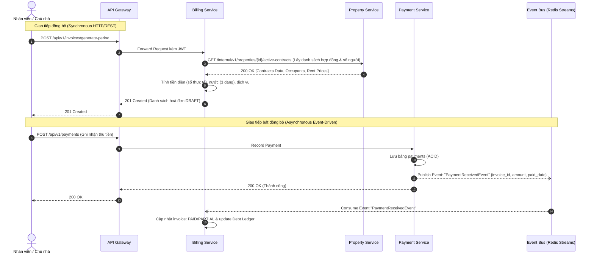
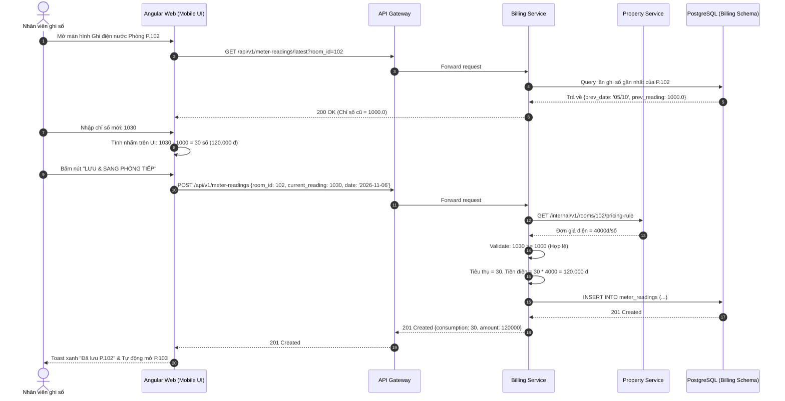
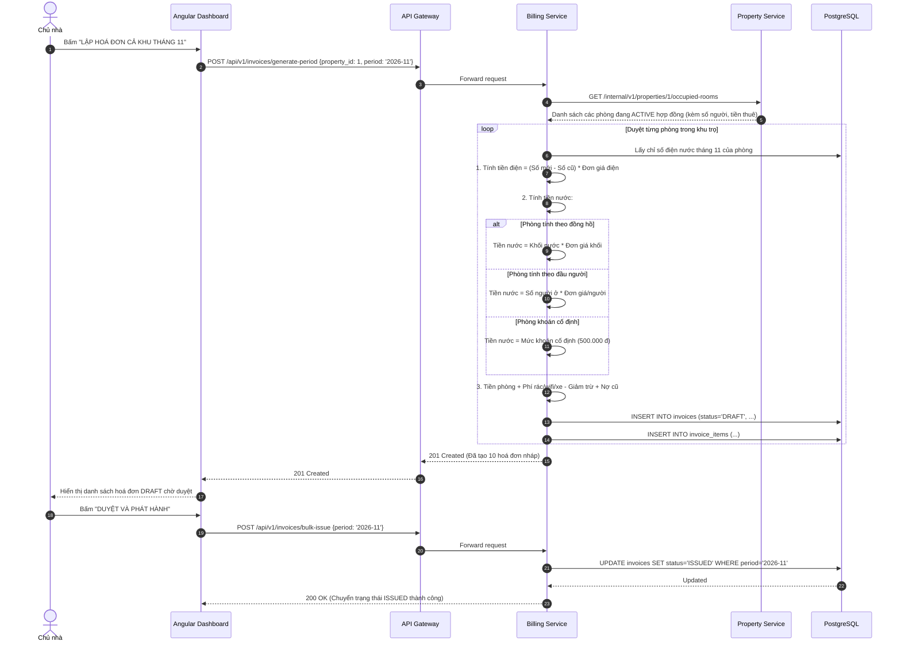
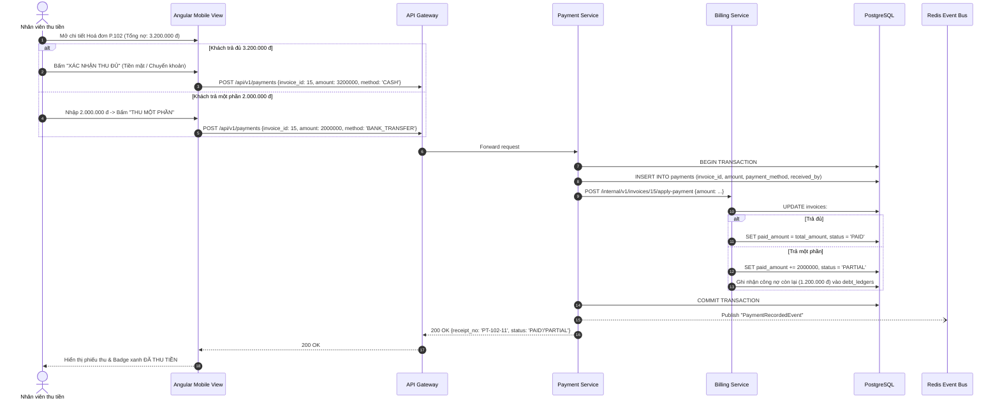
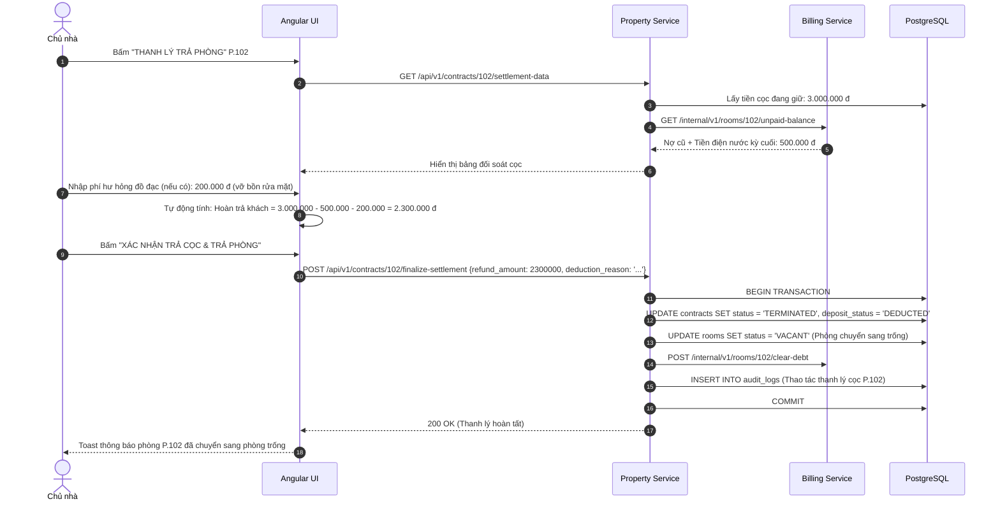
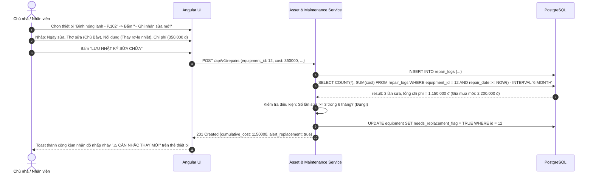

# TÀI LIỆU THIẾT KẾ CHI TIẾT HỆ THỐNG (DETAILED DESIGN SPECIFICATION)
## DỰ ÁN: RENTAL PROPERTY MANAGEMENT SYSTEM (RPMS)
### Hệ thống quản lý phòng trọ và nhà cho thuê theo kiến trúc Microservices

- **Phiên bản:** 1.0
- **Ngày lập:** 12/11/2026
- **Tác giả:** Nguyễn Huy Hoàng & Đội ngũ Kiến trúc sư Phần mềm
- **Tài liệu tham chiếu:** 
  - [01_BRD_He_thong_quan_ly_toa_nha.md](file:///d:/My_Project/building-management-system/docs/01_BRD_He_thong_quan_ly_toa_nha.md) (v2.0)
  - [02_SRS_He_thong_quan_ly_toa_nha.md](file:///d:/My_Project/building-management-system/docs/02_SRS_He_thong_quan_ly_toa_nha.md) (v2.0)
  - Bộ giao diện mẫu Google Stitch trong thư mục `docs/stitch_screens/`

---

# MỤC LỤC
1. [Kiến trúc tổng thể hệ thống Microservices](#1-kiến-trúc-tổng-thể-hệ-thống-microservices)
2. [Techstack đơn giản và tối ưu](#2-techstack-đơn-giản-và-tối-ưu)
3. [Tiêu chuẩn viết mã (Coding Conventions) và Bảo mật (Security)](#3-tiêu-chuẩn-viết-mã-coding-conventions-và-bảo-mật-security)
4. [Đặc tả API theo chuẩn OpenAPI 3.0](#4-đặc-tả-api-theo-chuẩn-openapi-30)
5. [Thiết kế chi tiết API, Sequence Diagrams và Method Signatures](#5-thiết-kế-chi-tiết-api-sequence-diagrams-và-method-signatures)
6. [Cấu trúc phân cấp thư mục mã nguồn Monorepo](#6-cấu-trúc-phân-cấp-thư-mục-mã-nguồn-monorepo)

---

# 1. KIẾN TRÚC TỔNG THỂ HỆ THỐNG MICROSERVICES

## 1.1. Chiến lược phân tách Microservices (Decomposition Strategy)

Dựa trên nguyên lý **Domain-Driven Design (DDD)** và các phân hệ nghiệp vụ đã được chuẩn hóa tại SRS v2.0 (`RPMS-01` đến `RPMS-06`), hệ thống được phân tách thành **5 Core Microservices độc lập** cùng với **1 API Gateway**:

```
+--------------------------------------------------------------------------------------------------+
|                                    CLIENT APPLICATION (ANGULAR FE)                               |
+--------------------------------------------------------------------------------------------------+
                                               │ HTTPS / WSS
                                               ▼
+──────────────────────────────────────────────────────────────────────────────────────────────────+
|                                API GATEWAY / REVERSE PROXY (KONG / NGINX)                        |
|  - SSL Termination       - Rate Limiting (Token Bucket)  - Request Routing                       |
|  - CORS Enforcement      - JWT Signature Pre-validation  - Centralized Access Logs               |
+──────────────────────────────────────────────────────────────────────────────────────────────────+
        │                        │                     │                     │
        ▼                        ▼                     ▼                     ▼
┌──────────────────┐   ┌──────────────────┐  ┌──────────────────┐  ┌──────────────────┐
│   AUTH SERVICE   │   │ PROPERTY-SERVICE │  │ BILLING-SERVICE  │  │ ASSET-MAINTENANCE│
│ (Identity & RBAC)│   │ (Properties,     │  │ (Meters, Utility,│  │     SERVICE      │
│                  │   │  Rooms, Tenants, │  │  Invoices, Debt) │  │ (Equipment,      │
│                  │   │  Contracts, Cọc) │  │                  │  │  Repair Logs)    │
└──────────────────┘   └──────────────────┘  └──────────────────┘  └──────────────────┘
        │                        │                     │                     │
        └────────────────────────┼─────────────────────┴─────────────────────┘
                                 ▼
                     ┌───────────────────────┐
                     │    PAYMENT-SERVICE    │
                     │ (Cash/Bank, Ledger,   │
                     │  VietQR, Deductions)  │
                     └───────────────────────┘
                                 │
     ────────────────────────────┴─────────────────────────────
     ASYNCHRONOUS EVENT BUS / MESSAGE BROKER (REDIS STREAMS / RABBITMQ)
     (Events: ContractTerminated, UtilityRecorded, InvoiceIssued, PaymentReceived)
```

### Chi tiết vai trò từng dịch vụ:

1. **`api-gateway` (Port 80/443 -> Internal 8000):**
   - Điểm tiếp nhận duy nhất cho toàn bộ yêu cầu từ Web Client.
   - Định tuyến URL (`/api/v1/auth/*` -> Auth Service; `/api/v1/properties/*` -> Property Service...).
   - Kiểm tra sơ bộ tính hợp lệ của JWT token (Header `Authorization: Bearer <token>`).

2. **`auth-service` (Port 8001):**
   - Quản lý tài khoản người dùng hệ thống: **Chủ nhà (Owner)** và **Nhân viên thu phí (Staff)**.
   - Cấp phát Access Token (JWT, TTL: 15 phút) và Refresh Token (TTL: 7 ngày, lưu trữ HttpOnly Cookie).
   - Quản lý bảng phân quyền theo phạm vi khu trọ `user_properties` (Nhân viên nào được phụ trách khu trọ nào).

3. **`property-service` (Port 8002):**
   - Quản lý danh mục bất động sản (`properties`), danh sách phòng trọ (`rooms`).
   - Cấu hình quản lý số người (`has_occupant_tracking: boolean`) và loại hình tính nước mặc định.
   - Quản lý hồ sơ người thuê (`tenants` - Master data).
   - Vòng đời hợp đồng (`contracts`): `DRAFT` -> `ACTIVE` -> `EXPIRING` -> `TERMINATED`.
   - Quản lý tiền cọc (`deposit_amount`), xử lý nghiệp vụ đối trừ cọc và thanh lý phòng.

4. **`billing-service` (Port 8003) - Động cơ tính phí:**
   - Quản lý công tơ và chỉ số điện nước theo mốc ngày đo (`meter_readings`).
   - Thực thi thuật toán tính tiền điện: $\text{Số điện} = (\text{Chỉ số mới} - \text{Chỉ số cũ}) \times \text{Đơn giá}$.
   - Thực thi 3 thuật toán tính tiền nước: (1) Theo đồng hồ khối nước; (2) Theo đầu người ở; (3) Khoán cố định phòng/tháng.
   - Quy trình lập hóa đơn tự động hàng tháng (Billing Pipeline): Tạo bản nháp `DRAFT` -> Chủ nhà duyệt `ISSUED`.
   - Động cơ công nợ (Debt Engine): Theo dõi tiền còn thiếu, tính phạt chậm nợ, phân loại 5 phân khúc nợ.

5. **`payment-service` (Port 8004):**
   - Tiếp nhận và ghi nhận thanh toán tiền mặt hoặc chuyển khoản ngân hàng (hỗ trợ sinh payload VietQR).
   - Hỗ trợ thanh toán toàn bộ (`PAID`) hoặc thanh toán một phần (`PARTIAL`).
   - Quản lý sổ quỹ phiếu thu và lịch sử giao dịch bất biến.

6. **`asset-service` (Port 8005):**
   - Quản lý tài sản trang thiết bị gắn với từng phòng hoặc khu vực dùng chung.
   - Ghi nhận nhật ký sửa chữa hỏng hóc (`repair_logs`), người chịu chi phí, thợ sửa chữa.
   - Động cơ phát hiện bất thường: Cảnh báo tự động thiết bị hỏng lặp lại $\ge 3$ lần trong 6 tháng.

---

## 1.2. Cơ chế giao tiếp liên dịch vụ (Inter-Service Communication)

Hệ thống kết hợp linh hoạt 2 cơ chế để đảm bảo tốc độ phản hồi nhanh và tính độc lập (loose coupling):



- **Đồng bộ (Synchronous REST over HTTP/2):** Áp dụng cho các truy vấn lấy dữ liệu tức thời phục vụ giao diện (ví dụ: `billing-service` truy vấn thông tin người ở từ `property-service`). Có cấu hình **Timeout (3s)** và **Retry policy với Circuit Breaker**.
- **Bất đồng bộ (Asynchronous Event-Driven qua Redis Streams):** Áp dụng khi có sự kiện thay đổi trạng thái phát sinh (`PaymentReceived`, `InvoiceIssued`, `ContractTerminated`). Giúp các service không bị nghẽn và độc lập chịu lỗi.

---

## 1.3. Kiến trúc Cơ sở Dữ liệu: Schema-per-Service trên PostgreSQL

Để tối ưu chi phí hạ tầng trong giai đoạn đầu mà vẫn đảm bảo tính độc lập ranh giới dữ liệu của Microservices, hệ thống áp dụng chiến lược **Single PostgreSQL Instance - Multiple Schemas (Schema-per-service)**:

- `auth_schema`: `users`, `user_properties`, `roles`
- `property_schema`: `properties`, `rooms`, `tenants`, `contracts`, `contract_tenants`
- `billing_schema`: `fee_configs`, `meter_readings`, `invoices`, `invoice_items`
- `payment_schema`: `payments`, `debt_ledgers`
- `asset_schema`: `equipment`, `repair_logs`
- `audit_schema`: `audit_logs` (phục vụ lưu vết tập trung)

> [!IMPORTANT]
> **Quy tắc tuyệt đối:** Không thực hiện câu lệnh SQL `JOIN` xuyên schema giữa các service. Mọi tương tác lấy dữ liệu của nhau bắt buộc phải đi qua REST API nội bộ hoặc Event Bus.

---

# 2. TECHSTACK ĐƠN GIẢN VÀ TỐI ƯU

Hệ thống ưu tiên sử dụng cấu trúc công nghệ tinh gọn, ổn định, cộng đồng hỗ trợ lớn và tốc độ phát triển cao:

| Thành phần | Công nghệ lựa chọn | Phiên bản khuyến nghị | Lý do lựa chọn cốt lõi |
|---|---|---|---|
| **Frontend Framework** | **Angular** | v18.x / v19.x | Kiến trúc module hóa rõ ràng, TypeScript nghiêm ngặt, cơ chế Standalone Components và Signals giúp quản lý State mượt mà không cần Redux cồng kềnh. |
| **UI Library / Styling** | **Tailwind CSS + Angular CDK** | v3.4+ | Tự do dựng giao diện chính xác theo nguyên bản mã HTML của Google Stitch; thiết kế Mobile-First cực nhanh với utility classes. |
| **Backend Framework** | **Python - FastAPI** | v0.115+ | Hiệu năng cao (dựa trên Starlette và Uvicorn ASGI), native `async/await`, tự động sinh tài liệu chuẩn **OpenAPI 3.0**, xác thực dữ liệu chặt chẽ bằng Pydantic v2. |
| **Data Validation / DTO** | **Pydantic** | v2.9+ | Viết bằng Rust core nên tốc độ parse/serialize nhanh gấp 5-10 lần Pydantic v1; tương thích hoàn hảo với TypeScript DTO interfaces. |
| **Database ORM** | **SQLAlchemy 2.0 (Async)** | v2.0+ | Hỗ trợ lập trình bất đồng bộ (`asyncpg`), kiểm soát Transaction ACID nghiêm ngặt cho nghiệp vụ tính tiền và thanh toán. |
| **Database Migration** | **Alembic** | v1.13+ | Quản lý lịch sử thay đổi cấu trúc bảng cơ sở dữ liệu theo từng microservice. |
| **Database Engine** | **PostgreSQL** | v16.x | Hỗ trợ kiểm tra ràng buộc toàn vẹn, kiểu dữ liệu `BIGINT` cho tiền tệ VNĐ, JSONB linh hoạt cho Audit Log. |
| **Cache & Event Broker** | **Redis** | v7.2+ | Tốc độ in-memory siêu tốc; dùng làm Rate-Limiter, lưu trữ Blocked JWT tokens và làm Event Broker nhẹ nhàng qua Redis Streams. |
| **API Gateway / Proxy** | **Nginx Reverse Proxy** | v1.26+ (hoặc Traefik) | Nhẹ nhàng, xử lý SSL Termination, cấu hình định tuyến microservices đơn giản bằng file `nginx.conf`. |
| **Containerization** | **Docker & Docker Compose** | v2.28+ | Đồng nhất môi trường từ phát triển cục bộ (Local Development) đến triển khai Production. |

---

# 3. TIÊU CHUẨN VIẾT MÃ (CODING CONVENTIONS) VÀ BẢO MẬT (SECURITY)

## 3.1. Tiêu chuẩn viết mã Backend (Python / FastAPI)

1. **Tuân thủ PEP 8 & Linter/Formatter tự động:**
   - Sử dụng **Ruff** làm công cụ kiểm tra cú pháp (linter) và định dạng mã (formatter) với cấu hình dòng tối đa 100 ký tự (`line-length = 100`).
   - Tuyệt đối cấm các import không sử dụng (`F401`), biến không sử dụng (`F841`).

2. **Quy tắc Type Hinting nghiêm ngặt (Strict Typing):**
   - 100% các hàm và phương thức (method signatures) bắt buộc phải khai báo kiểu dữ liệu cho tham số và giá trị trả về:
   ```python
   # Chuẩn:
   async def calculate_electricity_fee(previous_reading: float, current_reading: float, unit_price: int) -> int:
       if current_reading < previous_reading:
           raise InvalidMeterReadingException("Số điện kỳ này không được nhỏ hơn số kỳ trước")
       consumption: float = current_reading - previous_reading
       return int(consumption * unit_price)
   ```

3. **Cấu trúc phân tầng trong từng Microservice (Clean Layered Architecture):**
   - `routers/`: Chỉ tiếp nhận HTTP request, validate schema đầu vào, gọi service và trả về HTTP response. Không viết logic nghiệp vụ tại đây.
   - `services/`: Chứa toàn bộ Business Logic, các phép tính toán tài chính, kiểm tra quy tắc nghiệp vụ.
   - `repositories/`: Chuyên trách truy vấn cơ sở dữ liệu thông qua SQLAlchemy Async Session.
   - `schemas/`: Chứa các Pydantic Models (Request DTO, Response DTO).
   - `models/`: Chứa các SQLAlchemy ORM Entities mapping với bảng database.

---

## 3.2. Tiêu chuẩn viết mã Frontend (Angular)

1. **Kiến trúc Standalone Components:**
   - 100% components mới sử dụng kiến trúc `standalone: true`, loại bỏ sự phụ thuộc vào `NgModule` truyền thống.
2. **Quản lý State với Angular Signals:**
   - Sử dụng `signal()`, `computed()`, `effect()` để quản lý reactive state trong component. Tránh lạm dụng `BehaviorSubject` của RxJS khi không cần thiết.
3. **Change Detection Strategy:**
   - 100% component áp dụng chiến lược `changeDetection: ChangeDetectionStrategy.OnPush` để tối ưu hiệu năng hiển thị trên thiết bị di động.
4. **Quy tắc đặt tên (Naming Conventions):**
   - Tên file: `kebab-case` kèm hậu tố (ví dụ: `room-card.component.ts`, `meter-reading.service.ts`).
   - Tên Class: `PascalCase` (ví dụ: `RoomCardComponent`, `BillingService`).
   - Tên biến/hàm: `camelCase` (ví dụ: `currentReading`, `calculateTotalAmount()`).

---

## 3.3. Tiêu chuẩn Bảo mật hệ thống (Security Standards - OWASP Top 10)

### 1. Cơ chế Xác thực & Phiên làm việc (Authentication & Session)
- Áp dụng cơ chế **Stateless JWT** gồm cặp Token:
  - **Access Token:** Lưu thuật toán HMAC-SHA256, hạn sử dụng ngắn (**15 phút**). Payload chứa: `sub` (User ID), `role` (`OWNER` hoặc `STAFF`), `properties` (danh sách ID khu trọ được phân công).
  - **Refresh Token:** Hạn sử dụng **7 ngày**, được mã hóa và lưu tại Cookie trình duyệt với các cờ bảo mật bắt buộc: `HttpOnly; Secure; SameSite=Strict`. Khi Access Token hết hạn, Angular Interceptor tự động gọi endpoint `/api/v1/auth/refresh` để lấy token mới mà không làm gián đoạn người dùng.
- Mật khẩu người dùng được băm bằng thuật toán **Argon2id** (hoặc `bcrypt` với cost factor = 12). Tuyệt đối không lưu mật khẩu dạng plain-text.

### 2. Kiểm soát Phân quyền 2 tầng (Two-Tier Authorization)
Mỗi yêu cầu nghiệp vụ đều phải vượt qua 2 bước kiểm tra tại Backend:
- **Tầng 1 (Role-Based Access Control):** Kiểm tra vai trò của người dùng (`Owner` vs `Staff`). Ví dụ: Chỉ `Owner` mới được phép đổi bảng giá hoặc xóa tài khoản.
- **Tầng 2 (Property-Scope Enforcement - Ràng buộc khu trọ):** 
  ```python
  # Middleware/Dependency kiểm tra phạm vi khu trọ bắt buộc:
  async def verify_property_access(property_id: int, current_user: CurrentUser = Depends(get_current_user)):
      if current_user.role == "OWNER":
          return True
      if property_id not in current_user.assigned_property_ids:
          raise HTTPException(status_code=403, detail="Bạn không có quyền truy cập khu trọ này.")
      return True
  ```

### 3. Phòng chống các lỗ hổng phổ biến (OWASP Mitigations)
- **SQL Injection:** 100% truy vấn database sử dụng câu lệnh tham số hóa (Parameterized queries) thông qua SQLAlchemy ORM. Cấm tuyệt đối nối chuỗi SQL bằng `format()` hoặc f-string.
- **Cross-Site Scripting (XSS):** Angular tự động encode toàn bộ giá trị nội suy `{{ data }}`. Khi cần render HTML thô, bắt buộc phải lọc qua `DomSanitizer`.
- **CORS Configuration:** API Gateway chỉ cho phép các request đến từ tên miền Frontend được định nghĩa trong danh sách trắng (Whitelisted Origins).
- **Audit Log bất biến (Immutable Audit Trail):**
  - Mọi thao tác: Chỉnh sửa hóa đơn đã phát hành, điều chỉnh tiền cọc, đổi trạng thái hợp đồng đều phải ghi một bản ghi vào bảng `audit_logs` với cấu trúc: `user_id`, `action`, `resource_type`, `resource_id`, `before_state (JSONB)`, `after_state (JSONB)`, `created_at`.
  - Cấp quyền Database cho Application User chỉ được phép `INSERT`, cấm `UPDATE` và `DELETE` trên bảng `audit_logs`.

---

# 4. ĐẶC TẢ API THEO CHUẨN OPENAPI 3.0

Dưới đây là đặc tả chuẩn OpenAPI 3.0 cho các nhóm API cốt lõi nhất của hệ thống:

```yaml
openapi: 3.0.3
info:
  title: Rental Property Management System (RPMS) API
  version: 1.0.0
  description: Hệ thống RESTful API cho ứng dụng Quản lý phòng trọ và nhà cho thuê (Microservices Architecture).
servers:
  - url: https://api.quanlyphongtro.vn/api/v1
    description: Production Gateway
  - url: http://localhost:8000/api/v1
    description: Local Development Gateway

paths:
  # ==========================================
  # AUTH SERVICE ENDPOINTS
  # ==========================================
  /auth/login:
    post:
      tags: [Auth Service]
      summary: Đăng nhập hệ thống (Chủ nhà / Nhân viên)
      requestBody:
        required: true
        content:
          application/json:
            schema:
              $ref: '#/components/schemas/LoginRequest'
      responses:
        '200':
          description: Đăng nhập thành công, trả về Access Token
          content:
            application/json:
              schema:
                $ref: '#/components/schemas/LoginResponse'
        '401':
          $ref: '#/components/responses/UnauthorizedError'

  # ==========================================
  # PROPERTY SERVICE ENDPOINTS
  # ==========================================
  /properties:
    get:
      tags: [Property Service]
      summary: Lấy danh sách khu trọ thuộc quyền quản lý
      security:
        - BearerAuth: []
      responses:
        '200':
          content:
            application/json:
              schema:
                type: array
                items:
                  $ref: '#/components/schemas/PropertyResponse'

  /properties/{property_id}/rooms:
    get:
      tags: [Property Service]
      summary: Lấy danh sách phòng theo khu trọ (kèm trạng thái điện nước/thu tiền)
      security:
        - BearerAuth: []
      parameters:
        - name: property_id
          in: path
          required: true
          schema:
            type: integer
        - name: status
          in: query
          required: false
          schema:
            type: string
            enum: [ALL, VACANT, OCCUPIED, MAINTENANCE]
      responses:
        '200':
          content:
            application/json:
              schema:
                type: array
                items:
                  $ref: '#/components/schemas/RoomDetailResponse'

  # ==========================================
  # BILLING SERVICE ENDPOINTS
  # ==========================================
  /meter-readings:
    post:
      tags: [Billing Service]
      summary: Ghi nhận chỉ số điện nước theo ngày đo
      security:
        - BearerAuth: []
      requestBody:
        required: true
        content:
          application/json:
            schema:
              $ref: '#/components/schemas/CreateMeterReadingRequest'
      responses:
        '201':
          description: Đã lưu chỉ số và tự động tính tiêu thụ thành công
          content:
            application/json:
              schema:
                $ref: '#/components/schemas/MeterReadingResponse'
        '400':
          description: Chỉ số mới nhỏ hơn chỉ số cũ hoặc dữ liệu không hợp lệ

  /invoices/generate-period:
    post:
      tags: [Billing Service]
      summary: Tự động lập hoá đơn nháp (DRAFT) hàng loạt cho cả khu trọ theo kỳ
      security:
        - BearerAuth: []
      requestBody:
        required: true
        content:
          application/json:
            schema:
              type: object
              required: [property_id, billing_period]
              properties:
                property_id:
                  type: integer
                  example: 1
                billing_period:
                  type: string
                  example: "2026-11"
      responses:
        '201':
          description: Danh sách hoá đơn nháp đã được khởi tạo
          content:
            application/json:
              schema:
                type: array
                items:
                  $ref: '#/components/schemas/InvoiceSummaryResponse'

  # ==========================================
  # PAYMENT SERVICE ENDPOINTS
  # ==========================================
  /payments:
    post:
      tags: [Payment Service]
      summary: Ghi nhận thanh toán tiền phòng (Thu đủ hoặc Thu một phần)
      security:
        - BearerAuth: []
      requestBody:
        required: true
        content:
          application/json:
            schema:
              $ref: '#/components/schemas/CreatePaymentRequest'
      responses:
        '200':
          description: Ghi nhận thanh toán thành công
          content:
            application/json:
              schema:
                $ref: '#/components/schemas/PaymentReceiptResponse'

components:
  securitySchemes:
    BearerAuth:
      type: http
      scheme: bearer
      bearerFormat: JWT

  responses:
    UnauthorizedError:
      description: Token không hợp lệ hoặc đã hết hạn
      content:
        application/json:
          schema:
            $ref: '#/components/schemas/ErrorEnvelope'

  schemas:
    LoginRequest:
      type: object
      required: [username, password]
      properties:
        username:
          type: string
          example: "0912345678"
        password:
          type: string
          format: password
          example: "MatKhauBaoMat@123"

    LoginResponse:
      type: object
      properties:
        access_token:
          type: string
        token_type:
          type: string
          example: "bearer"
        expires_in:
          type: integer
          example: 900
        user:
          type: object
          properties:
            id: { type: integer, example: 1 }
            full_name: { type: string, example: "Nguyễn Văn Chủ Trọ" }
            role: { type: string, enum: [OWNER, STAFF] }
            assigned_properties: 
              type: array
              items: { type: integer }

    PropertyResponse:
      type: object
      properties:
        id: { type: integer, example: 1 }
        property_code: { type: string, example: "KT01" }
        name: { type: string, example: "Khu trọ Bình An" }
        address: { type: string, example: "Số 12 ngõ 45 Cầu Giấy, Hà Nội" }
        total_rooms: { type: integer, example: 12 }
        occupied_rooms: { type: integer, example: 10 }

    RoomDetailResponse:
      type: object
      properties:
        id: { type: integer, example: 102 }
        room_code: { type: string, example: "P.102" }
        status: { type: string, enum: [VACANT, OCCUPIED, MAINTENANCE] }
        base_price: { type: integer, example: 2500000 }
        water_billing_type: { type: string, enum: [BY_METER, BY_OCCUPANT, FLAT_MONTHLY] }
        tenant_name: { type: string, example: "Trần Thị B" }
        occupant_count: { type: integer, example: 3 }
        current_invoice_status: { type: string, enum: [NONE, DRAFT, ISSUED, PARTIAL, PAID] }
        is_meter_recorded: { type: boolean, example: false }

    CreateMeterReadingRequest:
      type: object
      required: [room_id, meter_type, current_reading, reading_date]
      properties:
        room_id: { type: integer, example: 102 }
        meter_type: { type: string, enum: [ELECTRICITY, WATER] }
        reading_date: { type: string, format: date, example: "2026-11-06" }
        current_reading: { type: number, example: 1030.0 }
        is_replacement: { type: boolean, default: false }
        notes: { type: string, example: "Chốt định kỳ đầu tháng" }

    MeterReadingResponse:
      type: object
      properties:
        id: { type: integer, example: 450 }
        room_id: { type: integer, example: 102 }
        previous_reading: { type: number, example: 1000.0 }
        current_reading: { type: number, example: 1030.0 }
        consumption: { type: number, example: 30.0 }
        calculated_amount: { type: integer, example: 120000 }
        recorded_at: { type: string, format: date-time }

    CreatePaymentRequest:
      type: object
      required: [invoice_id, amount, payment_method]
      properties:
        invoice_id: { type: integer, example: 15 }
        amount: { type: integer, example: 3200000 }
        payment_method: { type: string, enum: [CASH, BANK_TRANSFER] }
        notes: { type: string, example: "Khách nộp tiền mặt tại phòng" }

    PaymentReceiptResponse:
      type: object
      properties:
        receipt_id: { type: integer, example: 88 }
        invoice_id: { type: integer, example: 15 }
        amount_paid: { type: integer, example: 3200000 }
        remaining_debt: { type: integer, example: 0 }
        invoice_status: { type: string, example: "PAID" }
        transaction_time: { type: string, format: date-time }

    ErrorEnvelope:
      type: object
      properties:
        success: { type: boolean, example: false }
        error:
          type: object
          properties:
            code: { type: string, example: "ERR_INVALID_READING" }
            message: { type: string, example: "Chỉ số mới không được nhỏ hơn chỉ số cũ." }
            details: { type: array, items: { type: string } }
            timestamp: { type: string, format: date-time }
```

---

# 5. THIẾT KẾ CHI TIẾT API, WORKFLOWS VÀ METHOD SIGNATURES

## 5.1. Quy chuẩn cấu trúc phản hồi API (API Response Envelope)

Tất cả các API của toàn bộ các Microservices đều bắt buộc trả về theo định dạng vỏ bọc (envelope) thống nhất:

### Phản hồi thành công (HTTP 200, 201):
```json
{
  "success": true,
  "data": { ... },
  "message": "Thao tác thành công",
  "timestamp": "2026-11-12T14:30:00Z"
}
```

### Phản hồi lỗi (HTTP 400, 401, 403, 404, 422, 500):
```json
{
  "success": false,
  "error": {
    "code": "ERR_METER_READING_INVALID",
    "message": "Chỉ số mới (980) không được nhỏ hơn chỉ số cũ (1000).",
    "details": ["Field 'current_reading' must be >= 1000.00"],
    "timestamp": "2026-11-12T14:30:00Z"
  }
}
```

---

## 5.2. Các Sequence Diagrams chi tiết cho 6 Luồng nghiệp vụ cốt lõi

### Workflow 1: Ghi nhận chỉ số điện nước & Tự động tính toán (Meter Reading Live Calculation)



---

### Workflow 2: Lập hoá đơn tự động hàng tháng (Billing Pipeline)



---

### Workflow 3: Thu tiền phòng & Quản lý công nợ (Payment & Debt Collection)



---

### Workflow 4: Thanh lý phòng & Đối trừ tiền cọc (Check-out Settlement)



---

### Workflow 5: Ghi nhận sửa chữa & Cảnh báo thiết bị hỏng lặp lại



---

## 5.3. Chi tiết Method Signatures (Python / FastAPI Backend)

Dưới đây là các lớp giao diện dịch vụ (Service Interfaces) và hàm xử lý cốt lõi:

### 1. `BillingCalculationService` (Xử lý tính tiền điện nước)
```python
class BillingCalculationService:
    @staticmethod
    def calculate_electricity(
        previous_reading: float, 
        current_reading: float, 
        unit_price: int
    ) -> tuple[float, int]:
        """
        Tính số điện tiêu thụ và thành tiền điện theo số thực tế.
        Returns: (consumption_kwh, total_amount_vnd)
        """
        if current_reading < previous_reading:
            raise ValueError("Chỉ số mới không được nhỏ hơn chỉ số cũ.")
        consumption = round(current_reading - previous_reading, 2)
        amount = int(consumption * unit_price)
        return consumption, amount

    @staticmethod
    def calculate_water(
        billing_type: WaterBillingType,
        previous_reading: float | None,
        current_reading: float | None,
        unit_price_per_m3: int,
        occupant_count: int,
        unit_price_per_occupant: int,
        flat_monthly_price: int
    ) -> tuple[float, int]:
        """
        Tính tiền nước linh hoạt theo 3 hình thức:
        - BY_METER: Theo chỉ số khối nước
        - BY_OCCUPANT: Theo số người ở thực tế
        - FLAT_MONTHLY: Khoán cố định phòng/công ty thuê
        """
        if billing_type == WaterBillingType.BY_METER:
            if current_reading is None or previous_reading is None:
                raise ValueError("Thiếu chỉ số nước cho phòng tính theo đồng hồ.")
            consumption = round(current_reading - previous_reading, 2)
            return consumption, int(consumption * unit_price_per_m3)
            
        elif billing_type == WaterBillingType.BY_OCCUPANT:
            if occupant_count <= 0:
                raise ValueError("Số người ở phải lớn hơn 0 để tính nước theo đầu người.")
            return float(occupant_count), int(occupant_count * unit_price_per_occupant)
            
        elif billing_type == WaterBillingType.FLAT_MONTHLY:
            return 1.0, flat_monthly_price
            
        raise ValueError(f"Loại hình tính nước không hợp lệ: {billing_type}")
```

### 2. `ContractSettlementService` (Quyết toán tiền cọc khi trả phòng)
```python
class ContractSettlementService:
    async def settle_contract(
        self,
        db: AsyncSession,
        contract_id: int,
        final_utility_amount: int,
        damage_deduction_amount: int,
        deduction_reason: str | None,
        settled_by_user_id: int
    ) -> ContractSettlementResult:
        """
        Quyết toán hợp đồng và đối trừ tiền cọc:
        Số tiền hoàn trả = Tiền cọc - Tiền điện nước kỳ cuối - Phí hư hỏng
        """
        contract = await self.repo.get_contract(db, contract_id)
        if contract.status != ContractStatus.ACTIVE:
            raise InvalidContractStateException("Hợp đồng không ở trạng thái hiệu lực.")

        deposit = contract.deposit_amount
        total_deduction = final_utility_amount + damage_deduction_amount
        refund_amount = deposit - total_deduction

        # Thực thi Transaction
        contract.status = ContractStatus.TERMINATED
        contract.deposit_status = DepositStatus.DEDUCTED if total_deduction > 0 else DepositStatus.REFUNDED
        
        # Chuyển trạng thái phòng sang VACANT
        await self.room_repo.set_room_status(db, contract.room_id, RoomStatus.VACANT)
        
        # Ghi log kiểm toán
        await self.audit_repo.log(
            db=db,
            user_id=settled_by_user_id,
            action="TERMINATE_CONTRACT",
            resource_type="contracts",
            resource_id=contract_id,
            details={"deposit": deposit, "deducted": total_deduction, "refunded": refund_amount}
        )
        
        await db.commit()
        return ContractSettlementResult(refund_amount=refund_amount, contract_id=contract_id)
```

---

# 6. CẤU TRÚC PHÂN CẤP THƯ MỤC MÃ NGUỒN MONOREPO

Dự án được cấu trúc theo mô hình **Monorepo chuẩn**, giúp chia sẻ kiểu dữ liệu (DTO), thư viện dùng chung (Auth, Database utils) và triển khai toàn bộ hệ thống bằng 1 lệnh duy nhất (`docker compose up`):

```text
building-management-system/
├── .github/
│   └── workflows/
│       ├── frontend-ci.yml                 # CI cho Angular (Lint, Test, Build)
│       └── backend-ci.yml                  # CI cho Python FastAPI microservices
├── apps/
│   ├── frontend-web/                       # Ứng dụng Web Angular (Standalone + Signals)
│   │   ├── src/
│   │   │   ├── app/
│   │   │   │   ├── core/                   # Interceptors, Guards, Auth State Signal
│   │   │   │   │   ├── guards/auth.guard.ts
│   │   │   │   │   ├── interceptors/jwt.interceptor.ts
│   │   │   │   │   └── services/auth.service.ts
│   │   │   │   ├── features/               # Các module màn hình chức năng
│   │   │   │   │   ├── auth/login/
│   │   │   │   │   ├── room-grid/          # SCR-02: Dashboard danh sách phòng
│   │   │   │   │   ├── meter-reading/      # SCR-03: Ghi điện nước mobile
│   │   │   │   │   ├── invoice-payment/    # SCR-04: Bảng kê hoá đơn & Thu tiền
│   │   │   │   │   ├── contract-deposit/   # SCR-05: Quản lý hợp đồng & cọc
│   │   │   │   │   └── asset-repairs/      # SCR-06: Thiết bị & Nhật ký sửa chữa
│   │   │   │   └── shared/                 # UI Components dùng chung (Modal, Card, Badges)
│   │   │   ├── assets/
│   │   │   └── styles.css                  # Cấu hình Tailwind CSS
│   │   ├── angular.json
│   │   ├── package.json
│   │   └── tsconfig.json
│   │
│   └── api-gateway/                        # Nginx Reverse Proxy & SSL Gateway
│       ├── conf.d/
│       │   └── default.conf                # Quy tắc định tuyến microservices
│       └── Dockerfile
│
├── services/                               # Các Python FastAPI Microservices
│   ├── auth_service/
│   │   ├── src/
│   │   │   ├── api/v1/routers/             # Auth Router (login, refresh, users)
│   │   │   ├── models/                     # SQLAlchemy User models
│   │   │   ├── schemas/                    # Pydantic schemas
│   │   │   ├── services/                   # JWT & Password verification service
│   │   │   └── main.py                     # FastAPI entry point (Port 8001)
│   │   ├── requirements.txt
│   │   └── Dockerfile
│   │
│   ├── property_service/                   # Quản lý khu trọ, phòng, khách, hợp đồng
│   │   ├── src/
│   │   │   ├── api/v1/routers/
│   │   │   ├── models/                     # Property, Room, Tenant, Contract
│   │   │   ├── schemas/
│   │   │   ├── services/                   # Room allocation & Deposit settlement
│   │   │   └── main.py                     # Port 8002
│   │   ├── requirements.txt
│   │   └── Dockerfile
│   │
│   ├── billing_service/                    # Động cơ tính phí & Hoá đơn
│   │   ├── src/
│   │   │   ├── api/v1/routers/             # Meters & Invoices endpoints
│   │   │   ├── models/                     # MeterReading, Invoice, InvoiceItem
│   │   │   ├── schemas/
│   │   │   ├── services/                   # BillingCalculationEngine, DebtEngine
│   │   │   └── main.py                     # Port 8003
│   │   ├── requirements.txt
│   │   └── Dockerfile
│   │
│   ├── payment_service/                    # Thu tiền, Quỹ tiền & Phiếu thu
│   │   ├── src/
│   │   │   ├── api/v1/routers/
│   │   │   ├── models/                     # Payment, DebtLedger
│   │   │   ├── schemas/
│   │   │   ├── services/                   # VietQR generator, PaymentReceipt
│   │   │   └── main.py                     # Port 8004
│   │   ├── requirements.txt
│   │   └── Dockerfile
│   │
│   └── asset_service/                      # Quản lý thiết bị & Sửa chữa
│       ├── src/
│       │   ├── api/v1/routers/
│       │   ├── models/                     # Equipment, RepairLog
│       │   ├── schemas/
│       │   ├── services/                   # Anomaly Detection (>= 3 times/6 months)
│       │   └── main.py                     # Port 8005
│       ├── requirements.txt
│       └── Dockerfile
│
├── packages/                               # Thư viện dùng chung (Shared Packages)
│   ├── common_py/                          # Shared Python Library
│   │   ├── common/
│   │   │   ├── auth/                       # JWT decoding & Role verification dependency
│   │   │   ├── database/                   # Base Async Engine & Sessionmaker
│   │   │   ├── exceptions/                 # Custom Exception Handlers & Error Envelope
│   │   │   └── logging/                    # Structured JSON Logger
│   │   └── pyproject.toml
│   │
│   └── common_types/                       # Shared TypeScript Interfaces (Sync với Pydantic)
│       ├── models.d.ts
│       └── package.json
│
├── deploy/                                 # Cấu hình triển khai hạ tầng
│   ├── docker-compose.yml                  # Môi trường chạy full stack cục bộ
│   ├── docker-compose.prod.yml             # Môi trường Production
│   ├── init-db/
│   │   └── 01-init-schemas.sql             # Khởi tạo 6 Schemas trong PostgreSQL
│   └── .env.example                        # Mẫu cấu hình biến môi trường
│
├── docs/                                   # Tài liệu kỹ thuật dự án
│   ├── 01_BRD_He_thong_quan_ly_toa_nha.md
│   ├── 02_SRS_He_thong_quan_ly_toa_nha.md
│   ├── 03_Detailed_Design_He_thong_quan_ly_nha_cho_thue.md   # Tài liệu này
│   └── stitch_screens/                     # Bộ prototype mã HTML & ảnh do Stitch tạo
│
├── Makefile                                # Lệnh tắt: make run, make test, make lint
└── README.md
```

---

## 7. KẾT LUẬN VÀ KẾ HOẠCH BÀN GIAO CHO ĐỘI NGŨ LẬP TRÌNH (HANDOFF)

Tài liệu Thiết kế Chi tiết này đóng vai trò là **kim chỉ nam kỹ thuật chuẩn xác** để toàn bộ lập trình viên Backend và Frontend phối hợp phát triển:
1. **Lập trình viên Backend:** Dựa vào Mục 1 (Kiến trúc Microservices), Mục 4 (OpenAPI 3.0), Mục 5 (Method Signatures & Database Schemas) để dựng khung ứng dụng FastAPI, triển khai các thuật toán tính điện nước, xử lý tiền cọc và API endpoints.
2. **Lập trình viên Frontend:** Dựa vào Mục 2 (Angular 18 Standalone + Signals), Mục 4.2 của SRS và bộ mã HTML nguyên bản tại `docs/stitch_screens/` để chuyển đổi nhanh chóng thành các Angular Components hoàn chỉnh.
3. **Kỹ sư DevOps:** Dựa vào Mục 6 (Monorepo) và cấu hình Docker Compose để triển khai hệ thống môi trường phát triển cục bộ và pipeline CI/CD kiểm tra tự động.

